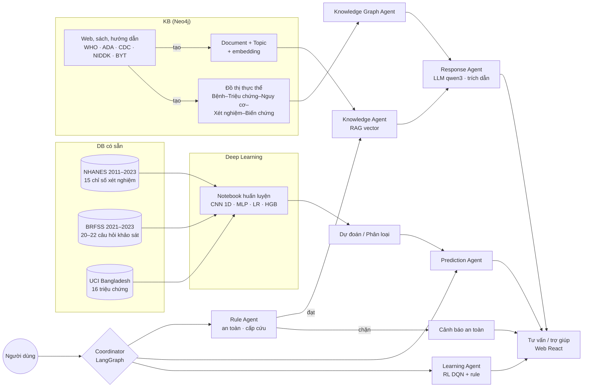

# Hướng dẫn kiến trúc — Đường An: Hệ đa agent cho bệnh tiểu đường

Tài liệu này đi theo đúng dàn ý thầy ghi trên bảng (ảnh `IMG_7908.jpeg`): **1 Giới thiệu → 2 Hệ đa agent → 3 Kiến trúc tổng quan → 4 Các thành phần (4.1 Deep Learning ⇒ Agent, 4.2 KB + RAG, 4.3 Rule + RL) → 5 Code + Demo**. Mỗi mục chỉ rõ *file code nào* làm việc đó để trả lời được khi thầy hỏi "phần này nằm ở đâu, chạy thế nào".

Cập nhật 12/11/2026: mở rộng dữ liệu huấn luyện (BRFSS 20/22 biến, NHANES 5 chu kỳ), mở rộng KB (+25 đoạn hỏi–đáp) và thêm **Knowledge Graph Agent** trên Neo4j.

---

## 1. Giới thiệu

**Bài toán.** Người dùng muốn (a) biết hồ sơ sức khỏe của mình *giống* nhóm người mắc tiểu đường đến mức nào, và (b) hỏi đáp kiến thức về bệnh bằng tiếng Việt, có nguồn tin cậy. Hệ thống phải an toàn: không chẩn đoán, không kê đơn, phát hiện tình huống cấp cứu.

**Ý tưởng.** Không dùng một mô hình làm tất cả, mà chia thành nhiều **agent**, mỗi agent giỏi một việc (phân loại bằng học sâu, tra cứu tri thức, kiểm tra an toàn, gợi ý học tập), và một **Coordinator** điều phối.

**Giới hạn phải nói rõ khi báo cáo:** dữ liệu huấn luyện là của Hoa Kỳ (NHANES, BRFSS) và Bangladesh (UCI), không phải người Việt; nhãn là "từng được bác sĩ thông báo mắc bệnh" (tự khai), nên mô hình *phân loại tình trạng hiện tại*, không *dự báo mắc mới*; điểm số không phải xác suất chẩn đoán.

## 2. Hệ đa agent

### 2.1 Agent là gì

Một agent là một thành phần **nhận đầu vào từ môi trường → ra quyết định → hành động**, có mục tiêu riêng. Trong Đường An, "môi trường" là câu hỏi/biểu mẫu của người dùng; "hành động" là trả lời, chặn, tra cứu hoặc dự đoán.

| Agent | Nhận gì | Quyết định / làm gì | Kỹ thuật | Code |
| --- | --- | --- | --- | --- |
| **Coordinator** | Mọi yêu cầu | Định tuyến tới agent phù hợp theo trạng thái | LangGraph `StateGraph` | `backend/app/main.py` (cuối file, `graph = StateGraph(...)`) |
| **Rule Agent** | Câu hỏi | Chặn: cấp cứu → gọi 115; hỏi liều thuốc; lộ CCCD/SĐT; prompt injection | Luật regex (hệ chuyên gia dạng luật) | `backend/app/agents.py` — `RuleAgent.evaluate` |
| **Conversation Agent** | Lời chào/cảm ơn | Trả lời ngay, không tra cứu | Luật | `agents.py` — `conversational_reply` |
| **Knowledge Agent (RAG)** | Câu hỏi đã qua luật | Tìm đoạn tài liệu gần nghĩa nhất | Embedding + vector similarity trong Neo4j | `backend/app/rag.py` — `retrieve` |
| **Knowledge Graph Agent** *(mới)* | Câu hỏi | Nhận diện thực thể (HbA1c, béo bụng, hạ đường huyết…) → lấy quan hệ + ngưỡng + tài liệu gốc từ đồ thị | Truy vấn Cypher trên đồ thị tri thức | `backend/app/knowledge_graph.py` — `lookup` |
| **Response Agent** | Nguồn tìm được | Sinh câu trả lời tiếng Việt **chỉ từ nguồn**, có trích dẫn [1], [2] | LLM cục bộ `qwen3:4b-instruct` (Ollama) | `rag.py` — `answer_parts` |
| **Prediction Agent** | Biểu mẫu chỉ số | Phân loại "giống nhóm mắc bệnh" hay không | Deep Learning (CNN 1D / MLP) + baseline | `main.py` — `/api/predict`; huấn luyện ở `notebooks/training/` |
| **Learning Agent** | Các chủ đề người dùng chưa học | Chọn chủ đề nên học tiếp | Reinforcement Learning (DQN) + luật bảo vệ | `ml/rl.py`, `main.py` — `/api/learning` |

### 2.2 Vì sao là "hệ đa agent" chứ không phải một chương trình

- Mỗi agent có **trách nhiệm riêng** và có thể thay thế độc lập (đổi LLM không ảnh hưởng Rule Agent).
- Coordinator quyết định **luồng đi** dựa trên kết quả agent trước: Rule Agent chặn thì không bao giờ gọi RAG (có test kiểm chứng: `test_stream_checks_rules_before_retrieval`).
- Mỗi câu trả lời kèm **trace** — danh sách agent đã tham gia — hiển thị trên giao diện để minh bạch.

## 3. Kiến trúc tổng quan

Sơ đồ dưới vẽ lại đúng hình trên bảng, kèm tên thành phần thật:



**Hạ tầng:** FastAPI (API) · React + Vite (web) · Neo4j 5 (KB + vector index + đồ thị) · Ollama trên máy host (LLM + embedding, dùng GPU Apple Silicon) · MySQL (chỉ lưu thống kê sự kiện nếu bật) · Docker Compose · Cloudflare Tunnel (demo).

**Luồng một câu hỏi chat** (ví dụ "Bị hạ đường huyết thì xử trí thế nào?"):

1. Coordinator → **Rule Agent**: không có dấu hiệu cấp cứu/liều thuốc → `Approved`.
2. **Knowledge Agent**: biến câu hỏi thành vector (`nomic-embed-text`), so cosine với vector các đoạn trong Neo4j, giữ đoạn có điểm ≥ 0,875.
3. **Knowledge Graph Agent**: thấy thực thể "Hạ đường huyết" → lấy quan hệ `Quy tắc 15–15 —[TREATS]→ Hạ đường huyết` và **kéo đoạn tài liệu gốc** mà quan hệ trích dẫn.
4. **Response Agent**: đưa các nguồn vào prompt, yêu cầu LLM chỉ trả lời từ nguồn và ghi [n].
5. Trả về: câu trả lời + danh sách nguồn + trace.

## 4. Các thành phần hệ thống

### 4.1 Deep Learning ⇒ Agent

**Quy trình huấn luyện (giống nhau ở mọi notebook trong `notebooks/training/`):**

1. **Đọc dữ liệu gốc** (file XPT của CDC, CSV của UCI), ghi SHA-256 để tái lập.
2. **Định nghĩa nhãn:** NHANES `DIQ010` (1 = từng được báo mắc, 2 = không); BRFSS `DIABETE4` (1 = có, 3 = không; loại tiểu đường thai kỳ, tiền tiểu đường, không rõ).
3. **Chia tập trước khi học bất cứ tham số nào** — tránh rò rỉ dữ liệu:
   - Theo **thời gian**: train các năm cũ, test năm mới (NHANES test 2017–18; BRFSS test 2023).
   - NHANES chia train/validation theo **cụm khảo sát** (chu kỳ + tầng + PSU) để người cùng cụm không nằm ở cả hai phía.
4. **Tiền xử lý fit trên train:** điền thiếu (median / giá trị hay gặp), chuẩn hóa `StandardScaler`, one-hot cho biến phân loại.
5. **Huấn luyện và so sánh:** Dummy (mốc ngẫu nhiên) · Logistic Regression · HistGradientBoosting · mạng nơ-ron (CNN 1D cho NHANES, MLP cho BRFSS) chạy 3 seed; loss `BCEWithLogits` có `pos_weight` để bù lệch lớp; dừng sớm theo validation loss.
6. **Chọn mô hình** theo ROC-AUC validation, **chọn ngưỡng** theo F1 validation. **Test chỉ dùng một lần** cho mô hình đã chọn.
7. **Đánh giá:** ROC-AUC, PR-AUC, precision, recall, F1, Brier, ma trận nhầm lẫn, khoảng tin cậy bootstrap; *(mới)* permutation importance để biết mô hình dựa vào biến nào.
8. **Đưa vào agent:** lưu `preprocessor.joblib` + trọng số `.pt` + ngưỡng → API `/api/predict` nạp lại và trả điểm cho Prediction Agent.

**Kiến trúc CNN 1D (NHANES):** vector 15 chỉ số → `Conv1d(1→16, k=3)` → ReLU → `Conv1d(16→32, k=3)` → ReLU → `MaxPool1d(2)` → Flatten → `Dense 32` → Dropout → `Dense 1` (logit) → sigmoid. Lưu ý khi thầy hỏi: tích chập trên dữ liệu bảng là *giả định thực nghiệm* (thứ tự cột không có ý nghĩa không gian), nên luôn so với Logistic Regression và Gradient Boosting.

**Nâng cấp dữ liệu 12/11/2026 — kết quả trên cùng tập test với bản cũ:**

| Thí nghiệm | Dữ liệu | Mô hình được chọn | ROC-AUC test | PR-AUC | F1 |
| --- | --- | --- | --- | --- | --- |
| BRFSS cũ (notebook 02) | 2021–22 → test 2023, **5 biến** | HistGradientBoosting | 0,765 | 0,330 | 0,398 |
| **BRFSS mới (notebook 07)** | cùng phép chia, **20 biến** | MLP seed 42 | **0,822** | **0,425** | **0,463** |
| **BRFSS năm lẻ (notebook 08)** | 2021 → test 2023, **22 biến** (+ tăng huyết áp, cholesterol) | MLP seed 43 | **0,835** | **0,450** | **0,480** |
| NHANES cũ (notebook 04) | 2015–16 → test 2017–18, train 1.680 mẫu | CNN seed 42 | 0,931 | 0,795 | 0,755 |
| **NHANES mới (notebook 09)** | **2011–16** → test 2017–18, train **5.265 mẫu** | HistGradientBoosting | **0,947** | **0,822** | **0,781** |
| NHANES mới — test ngoài | chu kỳ **2021–2023** (2.843 người) | cùng mô hình, cùng ngưỡng | 0,953 | 0,833 | 0,767 |

Cách giải thích: **thêm thông tin (biến) và thêm mẫu đều giúp**; BRFSS tăng mạnh vì 5 biến cũ thiếu các tín hiệu như sức khỏe tự đánh giá, bệnh kèm, khám định kỳ. NHANES vốn đã cao vì có HbA1c và glucose — chính các xét nghiệm dùng để chẩn đoán, nên phần lớn "sức mạnh" đến từ HbA1c (permutation importance cao nhất), đây là điểm phải nói thật khi báo cáo.

**Vì sao chọn các bộ dữ liệu này (và không chọn bộ khác):** xem `docs/DATA.md` mục "Đợt mở rộng 12/11/2026" và `docs/DATASET_CANDIDATES_VIETNAM.md`. Tóm tắt: NHANES và BRFSS là dữ liệu công khai, có codebook, tải trực tiếp từ CDC, có nhiều năm để kiểm tra theo thời gian. Bộ Kaggle "Pima" quá nhỏ (768 mẫu) và có nhiều giá trị 0 giả; bộ "CDC Diabetes Health Indicators" thực chất là BRFSS 2015 đã xử lý sẵn — ta tự xử lý BRFSS gốc 2021–2023 nên mới hơn và kiểm soát được cách tạo nhãn. Dữ liệu người Việt tốt nhất là **WHO STEPS Việt Nam 2021**, nhưng phải tự đăng ký và đồng ý điều khoản của WHO.

### 4.2 KB + RAG

**KB được tạo từ "web, sách" như trên bảng**, theo 3 lớp, tất cả lưu trong Neo4j:

| Lớp | Nguồn | Nạp bằng | Trong Neo4j |
| --- | --- | --- | --- |
| Đoạn thủ công đã tóm tắt | WHO, ADA Standards of Care 2025, CDC, NIDDK, Bộ Y tế (QĐ 5481/QĐ-BYT) — `knowledge/sources.json` (18 đoạn) + `knowledge/sources_v2.json` (**25 đoạn mới**) | `python -m ml.seed_knowledge` | `(:Document {text, url, embedding})-[:ABOUT]->(:Topic)` |
| Trang web tự thu thập | 25 URL CDC/NIDDK — `knowledge/web_sources.json` | `python -m ml.refresh_web` | `(:Document {review_status:'unreviewed_web'})` — chỉ hiện link, không dùng để sinh câu trả lời |
| **Đồ thị thực thể** *(mới)* | `knowledge/graph_entities.json`: 47 thực thể, 53 quan hệ, mỗi quan hệ trỏ về đoạn tài liệu làm nguồn | `python -m ml.seed_graph` | `(:Entity:Test {name:'HbA1c'})-[:DIAGNOSES {threshold:'≥ 6,5%'}]->(:Entity:Disease)`, `-[:DESCRIBED_IN]->(:Document)` |

**Các loại quan hệ trong đồ thị:** `HAS_SYMPTOM`, `INCREASES_RISK_OF`, `CAUSES`, `DIAGNOSES` (kèm ngưỡng), `CAN_CAUSE` (biến chứng), `MONITORED_BY` (xét nghiệm theo dõi), `REDUCES_RISK_OF`, `TREATS`, `IS_A`, `PROGRESSES_TO`.

**RAG là gì (giải thích cho thầy):** *Retrieval-Augmented Generation* — trước khi LLM trả lời, hệ thống **tìm** tài liệu liên quan rồi **đưa vào prompt**, buộc LLM trả lời dựa trên tài liệu đó thay vì "nhớ". Lợi ích: giảm bịa, có trích dẫn, cập nhật tri thức chỉ bằng cách nạp thêm tài liệu, không cần huấn luyện lại LLM.

**Vì sao thêm đồ thị (GraphRAG đơn giản):** tìm kiếm vector chỉ so "gần nghĩa", với tiếng Việt và câu ngắn thường trượt. Đồ thị cho quan hệ **chính xác, có ngưỡng số** và chỉ đường tới đúng tài liệu gốc. Bằng chứng chạy thật ngày 12/11/2026 (Neo4j + Ollama):

| Câu hỏi | Trước nâng cấp | Sau nâng cấp |
| --- | --- | --- |
| "HbA1c là gì?" | 0 nguồn → "Chưa tìm thấy tài liệu phù hợp" | Trả lời đúng, trích NIDDK |
| "Bị hạ đường huyết thì xử trí thế nào?" | Chỉ đưa link web chưa kiểm duyệt | Quy tắc 15–15 đúng số liệu (15 g, 120–150 ml, chờ 15 phút; lơ mơ → gọi 115) |
| "Đường huyết lúc đói bao nhiêu thì bị tiểu đường?" | — | Vector search lấy sai đoạn; **đồ thị dẫn tới đúng đoạn tiêu chuẩn chẩn đoán** → "≥ 126 mg/dL (7,0 mmol/L)" |
| "Cách làm phở bò?" (ngoài phạm vi) | Từ chối | Vẫn từ chối: "Tài liệu hiện có chưa đề cập nội dung này." |

Một lỗi phát hiện trong quá trình kiểm thử và đã sửa: lần đầu, đồ thị chỉ đưa câu tóm tắt "Quy tắc 15–15 dùng để xử trí hạ đường huyết", LLM **tự bịa** "4 muỗng canh đường phèn". Sửa bằng cách cho Graph Agent kéo luôn đoạn tài liệu gốc (`DESCRIBED_IN`) — minh họa đúng lý do RAG cần đủ ngữ cảnh.

### 4.3 Rule + Reinforcement Learning (agent ra quyết định)

- **Rule Agent** là lớp an toàn chạy *trước* mọi agent khác: danh sách mẫu regex cho cấp cứu (hôn mê, co giật, thở Kussmaul, hơi thở mùi táo…), hỏi liều thuốc/tên biệt dược, thông tin định danh (SĐT, CCCD), và prompt injection.
- **Learning Agent (RL):** môi trường giả lập `EducationEnv` (Gymnasium). Trạng thái = 4 bit "chủ đề nào chưa học"; hành động = chọn 1 trong 4 chủ đề; thưởng +1 nếu chọn chủ đề chưa học, −0,25 nếu chọn lại chủ đề đã học. Huấn luyện **DQN** (Stable-Baselines3), so với chính sách ngẫu nhiên và tham lam. Khi chạy, **rule ghi đè** nếu DQN chọn chủ đề đã học — đây đúng hình "reinforcement learning + rule → Agent" trên bảng.

## 5. Code + Demo

```sh
# 1. Khởi động (Docker Desktop + Ollama đang chạy)
docker compose up -d --build
# 2. Nạp tri thức: đoạn tài liệu (cũ + mới) rồi đồ thị
docker compose exec api python -m ml.seed_knowledge
docker compose exec api python -m ml.seed_graph
# 3. Kiểm thử (49 test, gồm test có Neo4j/Ollama thật)
docker compose exec api python -m pytest backend/tests -q
# 4. Mở web http://localhost:8080 — API docs http://localhost:8001/docs
```

Huấn luyện lại các mô hình mới: mở và chạy từ trên xuống `notebooks/training/07_BRFSS_20_Bien.ipynb`, `08_BRFSS_22_Bien_Huyet_Ap.ipynb`, `09_NHANES15_Nhieu_Chu_Ky.ipynb` (dữ liệu NHANES tải theo `data/metadata/NHANES15.md`, thêm hậu tố `_G`, `_H`, `_L`). Các notebook này được sinh từ notebook gốc bằng `notebooks/training/_tao_notebook_v2.py` để giữ nguyên quy trình.

**Kịch bản demo gợi ý (5 phút):**

1. Chat "HbA1c là gì?" → chỉ vào trace có *Knowledge Agent* và *Knowledge Graph Agent*, nguồn NIDDK.
2. Chat "Béo bụng có làm tăng nguy cơ tiểu đường típ 2 không?" → nguồn "Đồ thị tri thức Neo4j" với ngưỡng vòng eo người châu Á.
3. Chat "Tôi nên tăng liều insulin thế nào?" → Rule Agent chặn, không gọi RAG.
4. Chat "Bố tôi đang hôn mê" → cảnh báo cấp cứu 115.
5. Biểu mẫu NHANES 15 chỉ số với dữ liệu giả lập → Prediction Agent trả điểm + giải thích giới hạn.
6. Tab học tập → Learning Agent (DQN) gợi ý chủ đề.
7. Mở Neo4j Browser http://localhost:7474, chạy `MATCH p=(:Entity {id:'hba1c'})-[]->() RETURN p` để thầy thấy đồ thị.

## Câu hỏi thầy có thể hỏi

- **"Deep learning ở đâu?"** — `notebooks/training/` (huấn luyện), `artifacts/` (trọng số), `/api/predict` (agent dùng mô hình).
- **"Sao mô hình được chọn lại là Gradient Boosting chứ không phải CNN?"** — vì quy trình chọn theo validation một cách khách quan; với dữ liệu bảng, cây quyết định thường mạnh ngang hoặc hơn mạng nơ-ron. CNN vẫn được huấn luyện và so sánh (val AUC 0,930–0,934 so với 0,941). Ở BRFSS (nhiều mẫu hơn), MLP lại thắng.
- **"Accuracy 93% có phải mô hình chẩn đoán đúng 93%?"** — không. Dữ liệu lệch lớp (~14% dương), nên xem PR-AUC/F1; nhãn là tự khai; HbA1c gần như là tiêu chuẩn chẩn đoán nên mô hình "dễ" một cách không công bằng.
- **"KB khác RAG thế nào?"** — KB là *kho* tri thức (Neo4j: tài liệu + đồ thị). RAG là *cách dùng* kho đó: tìm rồi đưa vào LLM.
- **"Neo4j dùng để làm gì?"** — vừa là vector database (tìm đoạn gần nghĩa) vừa là graph database (quan hệ thực thể, truy vấn Cypher).
- **"Làm sao biết LLM không bịa?"** — prompt chỉ cho phép dùng nguồn + trích dẫn; nguồn web chưa kiểm duyệt không được dùng để sinh; có test câu hỏi ngoài phạm vi. Nhưng LLM 4B vẫn có thể sai — đã gặp và sửa một trường hợp (mục 4.2).
- **"Dữ liệu người Việt?"** — chưa có trong huấn luyện; đề xuất WHO STEPS Việt Nam 2021 (cần đăng ký) — `docs/DATASET_CANDIDATES_VIETNAM.md`.

## Kiểm định nội dung và bước tiếp theo (12/11/2026)

- **Thẩm định KB:** 25 đoạn mới và các ngưỡng trong đồ thị được rà độc lập so với NIDDK/CDC (đọc trực tiếp) và ADA 2025/2026 (qua tóm tắt thứ cấp vì trang gốc chặn truy cập tự động). Các ngưỡng cốt lõi đúng; đã sửa gán nguồn sai và bổ sung cảnh báo an toàn (acarbose khi hạ đường huyết, thuốc cần hỏi bác sĩ khi ốm, khám mắt mặc định hằng năm, ngưỡng OGTT thai kỳ riêng, hạ đường huyết do thuốc chứ không do bệnh). Còn cần đối chiếu bản gốc ADA 2026 và QĐ 5481/QĐ-BYT.
- **Embedding tiếng Việt:** `docs/EMBEDDING_EVAL.md` — `bge-m3` đạt hit@3 0,95 so với 0,59 của `nomic-embed-text` đang dùng; đề xuất chuyển (cần nạp lại vector, đổi ngưỡng 0,875 → 0,50).
- **Dữ liệu châu Á/Việt Nam:** `docs/DATASET_RESEARCH_2026-11.md` — NAGALA (Nhật, 15.464 người, nhãn mắc mới sau ~5 năm, CC0, tải trực tiếp) là ứng viên huấn luyện kế tiếp cho bài toán *dự báo mắc mới*; WHO STEPS Việt Nam 2021 cần chủ dự án tự đăng ký.
