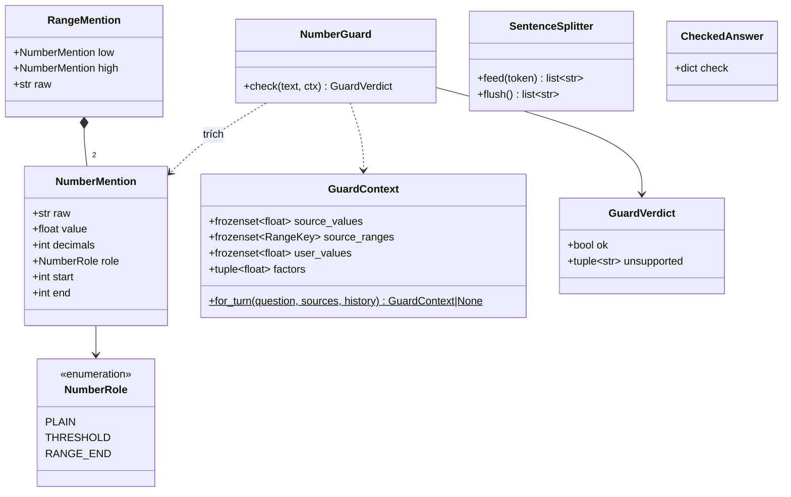
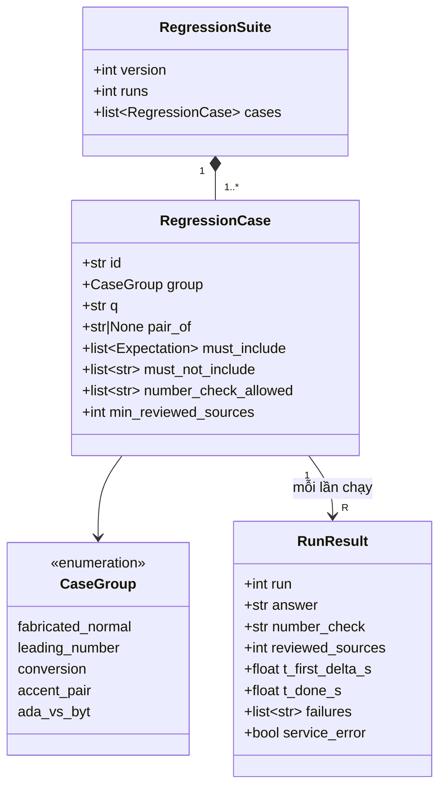

# REQ-DA-03 – Hậu kiểm số v2 + stream theo câu + bộ regression · design-data.md

- Người viết: Vega (Planner, lượt design-data) · Ngày: 2026-11-12 (giờ VN, UTC+7)
- Đầu vào: `analysis.md` đã được Atlas duyệt (nhận mặc định Q1–Q9). Không có UI nên không có `design-ui.md`.
- Skill dùng: `adr-and-mermaid-domain-model`. Không có persistence/DB mới (mục 6).

## 1. Tổng quan

```
answer_parts (rag, T1) ──token──▶ SentenceSplitter (T1) ──câu──▶ NumberGuard.check (T1) ──ok──▶ delta NDJSON (main.chat_stream, T2)
                                                                        └─vi phạm─▶ lược + ghi log ─▶ (cuối) REMOVED_NOTE | safe_fallback
/api/chat: rag.guard_answer (T1) = NumberGuard.check trên cả bài → sinh lại 1 lần → safe_fallback (như v1, luật v2)
Regression (T3): ml/run_answer_regression.py ──HTTP──▶ /api/chat/stream, chấm theo knowledge/answer_regression.json
```

Nguyên tắc: T1 sở hữu **mọi luật về số và về biên câu**; T2 chỉ ghép luồng, không tự quyết định câu nào hợp lệ. Nhờ vậy `/api/chat` và stream luôn cho cùng phán quyết trên cùng văn bản (AC-6).

## 2. Domain model





## 3. Interface T1 → T2 (chốt cứng – Rex code bằng fake theo đúng chữ ký này)

### 3.1 `backend/app/number_guard.py` (T1)

```python
from dataclasses import dataclass
from enum import Enum

class NumberRole(Enum):
    PLAIN = 'plain'          # số đứng một mình (nhắc lại số đo, số đếm, giá trị quy đổi)
    THRESHOLD = 'threshold'  # số đi với dấu hiệu ngưỡng (mục 4.2)
    RANGE_END = 'range_end'  # đầu mút của khoảng a–b

@dataclass(frozen=True)
class GuardVerdict:
    ok: bool
    unsupported: tuple[str, ...]   # nguyên văn như trong câu, không trùng, theo thứ tự xuất hiện;
                                   # khoảng ghi cả cụm "70–99"; số lẻ ghi "13,8". ok == (len(unsupported) == 0)

@dataclass(frozen=True)
class GuardContext:
    source_values: frozenset[float]                 # số của nguồn ĐÃ DUYỆT (title + url + text)
    source_ranges: frozenset[tuple[float, float]]   # khoảng (low, high) đúng thứ tự viết trong nguồn
    user_values: frozenset[float]                   # số trong câu hỏi + nội dung lượt 'user' của history
    factors: tuple[float, ...]                      # ⊆ (18.0, 38.7, 88.6), chỉ hệ số có trong source_values

    @staticmethod
    def for_turn(question: str, sources: list[dict], history: list[dict] | None = None) -> 'GuardContext | None':
        """None khi không có nguồn đã duyệt (review_status != 'unreviewed_web') → bỏ kiểm (status 'skipped')."""

class NumberGuard:
    def check(self, text: str, ctx: GuardContext) -> GuardVerdict:
        """Thuần, tất định, không I/O, không gọi LLM. text có thể là 1 câu hoặc cả bài."""

def find_unsupported(answer: str, *context: str) -> list[str]:
    """Giữ cho tương thích v1: coi mọi context là NGUỒN (không có user_values)."""

REMOVED_NOTE = ('Một phần nội dung có con số chưa được nguồn xác nhận nên đã được lược bỏ; '
                'vui lòng xem nguồn bên dưới.')
```

### 3.2 `backend/app/sentence_split.py` (T1, file mới)

```python
MAX_SENTENCE_CHARS = 400

class SentenceSplitter:
    """Nhận token theo luồng, trả các câu đã hoàn chỉnh. ''.join(mọi câu trả ra) == ''.join(mọi token)."""
    def feed(self, token: str) -> list[str]: ...   # 0..n câu hoàn chỉnh; giữ phần dở bên trong
    def flush(self) -> list[str]: ...              # gọi 1 lần khi LLM xong; trả phần còn lại (0..1 câu)
```

### 3.3 `backend/app/rag.py` (T1 – thay đổi chữ ký)

```python
def answer_parts(question, sources, history=None, forbidden_numbers=None, include_tail: bool = True): ...
    # include_tail=False: KHÔNG yield câu "Các nguồn web tự động khác…" ở cuối (stream tự phát qua unreviewed_tail)
def unreviewed_tail(sources: list[dict]) -> str | None: ...   # đúng chuỗi v1 (có '\n\n' đầu) hoặc None
def safe_fallback(sources: list[dict]) -> str: ...           # = _safe_fallback v1 (nhận sources gốc, tự lọc đã duyệt)

class CheckedAnswer(str):
    check: dict   # {'status': 'passed'|'regenerated'|'filtered'|'blocked'|'skipped',
                  #  'numbers': list[str], 'removed': int, 'total': int}
    def __new__(cls, text: str, status: str, numbers: list[str] | None = None,
                removed: int = 0, total: int = 0): ...
```
`guard_answer(...)` giữ chữ ký v1; bên trong dùng `GuardContext.for_turn` + `NumberGuard`. `'filtered'` chỉ do stream tạo (T2 dựng `CheckedAnswer`), `guard_answer` không trả `'filtered'`.

### 3.4 Fake cho Rex (dùng tới khi T1 merge)
```python
class FakeGuard:            # vi phạm khi câu chứa chuỗi trong self.bad
    def __init__(self, bad=('77', '70–99')): self.bad = bad
    def check(self, text, ctx): u = tuple(b for b in self.bad if b in text); return GuardVerdict(not u, u)
class FakeSplitter:         # tách ở '. ' và '\n' – đủ cho test luồng, không thay test của T1
```
T2 nhận `NumberGuard` và `SentenceSplitter` qua tham số mặc định của hàm sinh luồng (vd `_stream_answer(..., guard=NumberGuard(), splitter_factory=SentenceSplitter)`) để test thay bằng fake; không monkeypatch module của T1.

## 4. Luật guard v2 (T1)

### 4.1 Trích số và chuẩn hoá (giữ v1)
Regex `_NUMBER`, bỏ `[n]`, bỏ số thứ tự đầu dòng, bỏ số dính chữ (HbA1c, PMC123, dc26-S005). `5,6` = `5.6`; `1.000` = 1000. `decimals` = số chữ số sau dấu thập phân của nguyên văn (`13,9` → 1, `14` → 0). `130/80` = hai mention độc lập.

### 4.2 Gán vai trò (theo mệnh đề; mệnh đề ngắt ở `, ; : ( )` và biên câu)
1. **RANGE_END**: hai số nối bởi `–`, `—`, `-` (có/không khoảng trắng) hoặc từ `đến` (tuỳ chọn `từ` phía trước), cùng mệnh đề. `dc26-S005` không phải khoảng (đã loại ở 4.1).
2. **THRESHOLD**: số không thuộc khoảng mà trong cùng mệnh đề có dấu hiệu nằm trong **3 từ trước** số: `<, ≤, >, ≥` (không gồm `=`/`≈` – dùng cho quy đổi), `dưới`, `trên`, `từ`, `tối thiểu`, `tối đa`, `ít nhất`, `không quá`, `vượt`, `bình thường`, `mục tiêu`, `ngưỡng`; hoặc trong **3 từ sau** (bỏ qua đơn vị): `trở lên`, `trở xuống`, `hoặc thấp hơn`, `hoặc cao hơn`. So khớp không phân biệt hoa thường, trên chuỗi NFC.
3. Còn lại **PLAIN**.

Ví dụ: "dưới 6%" → THRESHOLD; "Mức 6% bạn nêu" → PLAIN; "từ 6,5% trở lên" → THRESHOLD; "70–99" → RANGE_END×2.

### 4.3 Quyết định hỗ trợ (theo thứ tự, gặp điều kiện đầu tiên thoả thì dừng)

| # | Áp cho vai trò | Được hỗ trợ khi |
|---|---|---|
| R0 | mọi vai trò | `value ∈ {0, 1, 2}` (miễn trừ v1, AC-5) |
| R1 | PLAIN, THRESHOLD | `value ∈ source_values` |
| R2 | khoảng (cả cặp) | `(low, high) ∈ source_ranges` (đúng thứ tự; `99–70` không khớp `70–99`) |
| R3 | PLAIN | `value` là **số suy ra** từ `base = source_values ∪ user_values` |
| R4 | THRESHOLD | `value` là số suy ra từ `base = source_values` (không từ câu hỏi) |
| R5 | khoảng (cả cặp) | ∃ `(a, b) ∈ source_ranges`, ∃ `f ∈ factors` cùng chiều: `low ≡ a op f` **và** `high ≡ b op f` |
| R6 | PLAIN | `value ∈ user_values` (nhắc lại số đo của người dùng) |
| — | khác | vi phạm |

Khoảng không qua R2/R5 → ghi **cả cụm** (vd `"70–99"`) vào `unsupported`, không ghi từng đầu. Một đầu mút của khoảng **không** được cứu bằng R1/R6.

### 4.4 Số suy ra và làm tròn
`x ≡ v op f` (op ∈ {÷, ×}) ⇔ `x == round_half_up(v op f, decimals(x))`, tính bằng `decimal.Decimal` (không dùng `round()` của Python vì là banker's rounding).
- **Bao gồm**: bằng đúng sau làm tròn half-up ở đúng số chữ số câu trả lời ghi. 250÷18 = 13,888… → nhận `13,89`, `13,9`, `14`; 9÷18 = 0,5 → nhận `0,5`, `1`.
- **Loại trừ**: mọi sai khác khác, kể cả lệch 1 đơn vị ở chữ số cuối: `13,8`, `13,88`, `13` bị từ chối. Không có sai số cộng thêm.
- Chỉ **một bước** quy đổi; `f` chỉ lấy từ `ctx.factors` (hệ số phải xuất hiện trong nguồn đã duyệt của lượt). HbA1c %↔mmol/mol: không có hệ số → chỉ qua R1/R2 (cặp có sẵn trong nguồn).
- Không kiểm đơn vị (mg/dL hay mmol/L): xem ADR-02, hệ quả xấu.

### 4.5 Prompt
Quy tắc 6 của prompt đổi thành: chỉ nêu con số có trong nguồn, **hoặc** quy đổi số đo của người dùng / số trong nguồn bằng hệ số có trong nguồn (ghi rõ phép chia/nhân); không dùng số nhớ từ bên ngoài. Quy tắc 7, 9 giữ.

## 5. Luồng `chat_stream` theo câu (T2)

### 5.1 Thứ tự sự kiện (schema v1, không thêm kiểu/trường)
```
delta{text}  × 0..n     (mỗi delta = 1 câu đã qua guard, hoặc REMOVED_NOTE, hoặc safe_fallback, hoặc tail)
done{sources, trace, disclaimer}  | error{message}     ← đúng 1 sự kiện kết thúc, không có gì sau nó
```

### 5.2 Thuật toán
1. Rule/blocked, conversation: **y hệt v1** (1 delta toàn văn).
2. `knowledge_node` → `sources`; `ctx = GuardContext.for_turn(question, sources, history)`.
3. `ctx is None` (không nguồn / chỉ nguồn web chưa duyệt): phát `answer_parts(...)` theo câu qua `SentenceSplitter`, **không kiểm**, status `skipped` (không có dòng trace Number check – như v1).
4. Ngược lại: `parts = answer_parts(..., include_tail=False)`; với mỗi câu từ `splitter.feed(token)` rồi `splitter.flush()`:
   - `total += 1` nếu câu có ≥ 1 chữ cái hoặc chữ số (câu chỉ khoảng trắng được gộp vào câu kế, không đếm);
   - `verdict = guard.check(câu, ctx)`; ok → `yield delta(câu)`, `emitted += 1`; không ok → `removed += 1`, gom `verdict.unsupported` (không trùng, giữ thứ tự), `log.warning('Number check: removed sentence %d, unsupported %s', idx, nums)` – **không log nội dung câu/câu hỏi** (NFR-10).
5. Kết thúc LLM:
   - `removed == 0` → status `passed`.
   - `removed > 0 and emitted > 0` → `yield delta('\n\n' + REMOVED_NOTE)`; status `filtered`.
   - `removed > 0 and emitted == 0` → `yield delta(safe_fallback(sources))`; status `blocked`.
   - Sau đó, nếu `unreviewed_tail(sources)` khác None và status ≠ `blocked` → `yield delta(tail)`.
6. Trace: thêm bước Response Agent như v1 rồi `number_check_trace(CheckedAnswer(text_đã_phát, status, numbers, removed, total))`; `history.record('chat')`; `yield done`.

### 5.3 `number_check_trace` (T2) – chuỗi chốt
| status | Dòng trace |
|---|---|
| passed | `Response Agent (Number check: passed)` |
| regenerated | `Response Agent (Number check: regenerated, unsupported: 77)` (v1) |
| filtered | `Response Agent (Number check: filtered 1/3 sentences, unsupported: 70–99)` (mới) |
| blocked | `Response Agent (Number check: blocked, unsupported: 77, 88)` (v1) |
| skipped | không có dòng |

`filtered` không chứa chữ "blocked" → `isBlockedTrace` của frontend không coi là bị chặn; `formatTrace` hiển thị nguyên văn (như `passed` hiện tại). Không sửa frontend.

### 5.4 Lỗi và ngắt kết nối
- Exception bất kỳ trong bước 2–6 → `log.exception` + `yield error(message v1)` rồi dừng. Câu đang dở trong splitter **bị bỏ**, không flush (AC-10).
- Ngắt kết nối client: generator nhận `GeneratorExit` → khối `finally` gọi `parts.close()` để đóng `httpx.stream` tới Ollama (EC-17); không `history.record`, không yield thêm.
- Không sinh lại khi stream (ADR-01). `/api/chat` giữ sinh lại 1 lần (§1).

## 6. Persistence & migration
Không có DB/bảng mới, không đổi dữ liệu Neo4j. File mới: `knowledge/answer_regression.json` (dữ liệu kiểm thử). Báo cáo chạy ghi vào `artifacts/answer_regression/` (đã bị `.gitignore` qua `artifacts/*`). Không có thay đổi phá huỷ → không cần PO approval.

## 7. Bộ regression (T3)

### 7.1 `knowledge/eval_questions.json` (giữ schema v1 vì `ml/eval_embeddings.py` đọc)
Thêm câu cho 4 chủ đề AC-12 (mỗi chủ đề 1 câu có dấu + 1 câu không dấu); `relevant` có ≥ 1 id có `issuer_of(url)` = ADA và ≥ 1 id = Bộ Y tế. Id có sẵn: `kb2-ai-nen-sang-loc` / `kb2-ai-nen-sang-loc-bytvn`, `kb2-muc-tieu-kiem-soat` / `kb2-muc-tieu-bytvn`, `kb2-muc-tieu-ha-ldl-ada` / `kb2-muc-tieu-bytvn`, `kb2-ruou-bia` / `kb2-ruou-bia-bytvn`.

### 7.2 `knowledge/answer_regression.json`
```json
{
  "version": 1,
  "runs": 3,
  "cases": [
    {
      "id": "RG-01",
      "group": "fabricated_normal",
      "q": "Chỉ số đường huyết lúc đói bình thường là bao nhiêu?",
      "must_include": [
        {"any": ["99 mg/dL hoặc thấp hơn", "dưới 100 mg/dL", "< 100 mg/dL"], "source_id": "kb2-duong-huyet-binh-thuong", "value": "99"}
      ],
      "must_not_include": ["70-99", "70 đến 99"],
      "number_check_allowed": ["passed", "regenerated", "filtered"],
      "min_reviewed_sources": 1
    },
    {
      "id": "RG-02", "group": "accent_pair", "pair_of": "RG-01",
      "q": "chi so duong huyet luc doi binh thuong la bao nhieu",
      "inherit": "RG-01"
    },
    {
      "id": "RG-10", "group": "ada_vs_byt",
      "q": "Huyết áp mục tiêu cho người tiểu đường là bao nhiêu?",
      "must_include": [
        {"any": ["130/80"], "near": ["ADA"], "window": 160, "source_id": "kb2-muc-tieu-kiem-soat", "value": "130/80"},
        {"any": ["140/90"], "near": ["Bộ Y tế"], "window": 160, "source_id": "kb2-muc-tieu-bytvn", "value": "140/90"}
      ],
      "must_not_include": [],
      "number_check_allowed": ["passed", "regenerated", "filtered"],
      "min_reviewed_sources": 2
    }
  ]
}
```
- `group` ∈ {`fabricated_normal`, `leading_number`, `conversion`, `accent_pair`, `ada_vs_byt`}; số lượng tối thiểu theo AC-13.
- `inherit`: dùng lại `must_include`/`must_not_include`/`number_check_allowed`/`min_reviewed_sources` của case kia (cặp có dấu/không dấu phải chấm cùng tiêu chí).
- So khớp chuỗi: NFC, chữ thường, gộp khoảng trắng, mọi dấu gạch `–—-` → `-` và bỏ khoảng trắng quanh nó, dấu thập phân `.` giữa hai chữ số → `,`. Chuẩn hoá áp cả hai phía.
- `near` + `window`: một chuỗi trong `near` xuất hiện trong ≤ `window` ký tự trước hoặc sau chuỗi khớp (bao gồm đúng `window`).
- `value` + `source_id`: test cấu trúc kiểm `value` có trong text của nguồn `source_id` (Kelp đối chiếu thêm với PDF gốc).
- Ví dụ case bắt buộc: `leading_number` "Có phải đường huyết lúc đói bình thường 70–99 không?", "Có phải HbA1c dưới 6% là bình thường không?"; `conversion` "Đường huyết tôi đo 250 mg/dL, đổi ra mmol/L là bao nhiêu?" (must_include `13,9` hoặc `14`); `ada_vs_byt` tuổi sàng lọc (`35`, `45`), LDL, rượu (must_include `10 g`, must_not_include `14 g`).

### 7.3 Lệnh chạy
```
python -m ml.run_answer_regression [--runs 3] [--base-url http://127.0.0.1:8001] [--group G ...] [--case RG-01 ...] [--out artifacts/answer_regression]
```
- Gọi `/api/chat/stream` (đường người dùng thật) tuần tự; timeout mỗi request 180 s. Ghi thêm `t_first_delta_s` (đến delta đầu có chữ) và `t_done_s` bằng `time.monotonic()` → dùng luôn cho NFR-1/NFR-2: baseline = chạy cùng lệnh `--runs 1 --group ...` vào server đang chạy code v1.
- Mã thoát: `0` mọi case PASS; `1` ≥ 1 case FAIL; `2` lỗi cấu hình (file sai schema, không kết nối được ở lần đầu).
- Hàm chấm thuần `evaluate(case, answer, number_check, reviewed_sources) -> list[str]` (danh sách lỗi), unit test được không cần dịch vụ.

### 7.4 Báo cáo (`<out>/<YYYYMMDDTHHMMSS+0700>.json` + `.md`)
```json
{"started_at": "2026-11-13T09:00:00+07:00", "commit": "abc1234", "model": "qwen3:4b-instruct",
 "base_url": "http://127.0.0.1:8001", "runs": 3,
 "summary": {"cases": 24, "passed": 22, "by_group": {"leading_number": {"cases": 4, "passed": 4}}},
 "ttft_s": {"p50": 3.8, "p95": 7.9, "n": 20},
 "cases": [{"id": "RG-01", "group": "fabricated_normal", "passed_runs": 3, "verdict": "PASS",
            "runs": [{"run": 1, "number_check": "passed", "reviewed_sources": 2, "t_first_delta_s": 3.1,
                      "t_done_s": 9.4, "failures": [], "service_error": false, "answer": "..."}]}]}
```
`.md` là bảng một dòng/case: id, nhóm, đạt/R, lỗi đầu tiên. Thời điểm theo giờ VN, ISO 8601 có offset, lấy bằng `ZoneInfo('Asia/Ho_Chi_Minh')` (không phụ thuộc TZ máy). `model` lấy từ biến môi trường `OLLAMA_MODEL` (mặc định như `rag.py`). Verdict case: PASS ⇔ `passed_runs == runs`; lần có `service_error` tính là không đạt (EC-21).

## 8. Quyết định thiết kế

### ADR-REQ-DA-03-01: Câu vi phạm khi stream – chọn lược câu thay vì sinh lại cả bài
- Status: accepted (Atlas nhận mặc định Q2, 2026-11-12)
- Date: 2026-11-12 · Liên quan: analysis.md AC-7, AC-8, NFR-1, NFR-4; task T2
**Context & Problem Statement** – v1 gom cả bài, kiểm, sinh lại tối đa 1 lần rồi mới phát → chữ đầu 8–17 s. Phát theo câu thì câu trước đã đến client; sự kiện stream không có kiểu "thu hồi" và frontend không được sửa (NFR-7). Cần chọn cách xử lý khi câu thứ k vi phạm.
**Decision Drivers** – NFR-1 (chữ đầu ≤ 5 s p50); NFR-4 (0 số không hỗ trợ đến client); NFR-7 (giữ schema); đơn giản, test được bằng fake.
**Considered Options** – (A) Giữ v1: gom cả bài rồi kiểm. (B) Phát theo câu, lược câu vi phạm, thêm 1 câu ghi chú; mọi câu vi phạm → câu an toàn. (C) Phát theo câu; gặp câu vi phạm thì dừng LLM, sinh lại *phần còn lại* với `forbidden_numbers`. (D) Phát theo câu nhưng giữ lại (buffer) tới khi đủ bài, gặp vi phạm thì sinh lại cả bài.
**Decision Outcome** – Chọn **B**. A và D không đạt NFR-1 (D xấu nhất khi có vi phạm: chờ 2 lần sinh). C nối hai lần sinh khó giữ mạch văn, thêm 1 lần gọi Ollama (~5–10 s giữa chừng) và nhiều trạng thái lỗi; lợi ích không tương xứng với một model 4B.
**Consequences** – Tốt: chữ đầu đến sau câu đầu tiên; không lần gọi LLM thêm; luồng tuyến tính, dễ test. Xấu (chấp nhận): câu trả lời có thể hụt ý (mất câu chứa số bịa) mà không được bù; stream và `/api/chat` có thể ra văn bản khác nhau cho cùng câu hỏi (một bên lược, một bên sinh lại); câu đúng nhưng có số guard không hiểu (phép tính khác quy đổi) cũng bị lược. Trung tính: thêm status `filtered` ở trace.
**Confirmation** – Test T2 (AC-7, AC-8, AC-10) với FakeGuard; regression NFR-4 = 0 số không hỗ trợ qua kiểm độc lập của Hawk; NFR-1 đo bằng runner §7.3.

### ADR-REQ-DA-03-02: Phân vai số – chọn luật từ vựng tất định thay vì nhờ LLM phân loại
- Status: accepted · Date: 2026-11-12 · Liên quan: AC-2, AC-3, AC-4; task T1
**Context & Problem Statement** – Cần phân biệt "6% bạn nêu" (nhắc lại) với "dưới 6% là bình thường" (ngưỡng mớm) và phát hiện khoảng ghép từ hai nguồn.
**Decision Drivers** – NFR-3 (≤ 20 ms/câu); kiểm được tất định; không thêm phụ thuộc LLM vào đường an toàn.
**Considered Options** – (A) Luật từ vựng + cửa sổ 3 từ (§4.2). (B) Gọi LLM phân loại vai trò từng số. (C) Không phân vai, cấm mọi số chỉ có trong câu hỏi.
**Decision Outcome** – Chọn **A**. B chậm (thêm 1–3 s/câu), ngẫu nhiên, và chính LLM là thứ đang cần kiểm. C chặn AC-1/AC-2 (quy đổi số đo của người dùng).
**Consequences** – Tốt: nhanh, tái lập, test bằng bảng. Xấu (chấp nhận): cách nói lách danh sách dấu hiệu ("cỡ 70 tới 99 là ổn") có thể lọt — giảm bằng bộ regression nhóm `leading_number`; không kiểm đơn vị nên một số bịa trùng ngẫu nhiên với `v÷18` sẽ qua; hệ số 18 có trong nguồn vì lý do khác ("18 tuổi") vẫn bật quy đổi.
**Confirmation** – Bảng AC-1…AC-4 thành test tham số của T1; nhóm `leading_number` PASS 3/3 (NFR-5).

Ràng buộc (không cần ADR): giữ schema NDJSON v1 và chuỗi trace v1 (NFR-7); phát hiện biên câu thuộc T1 để hai endpoint dùng chung luật.

## 9. Bảng task

| Task | assignee | Người | owned_paths (không chồng nhau) | Phủ | Phụ thuộc |
|---|---|---|---|---|---|
| REQ-DA-03-T1 | ai | Pollux | `backend/app/number_guard.py`, `backend/app/sentence_split.py` (mới), `backend/app/rag.py`, `backend/tests/test_number_guard.py`, `backend/tests/test_sentence_split.py` (mới) | AC-1…AC-6, EC-1…EC-15, EC-7…EC-11 (đơn vị), NFR-3, NFR-6 | — |
| REQ-DA-03-T2 | backend | Rex | `backend/app/main.py` – **chỉ** hàm `chat_stream` (và hàm phụ mới đặt ngay dưới nó) và `number_check_trace`; `backend/tests/test_chat_stream.py` (mới) | AC-7…AC-11, EC-16…EC-20, NFR-1 (đo bằng runner T3), NFR-2, NFR-7, NFR-8, NFR-10 | Interface §3 (code ngay bằng fake §3.4; chạy thật sau T1) |
| REQ-DA-03-T3 | ai | Pollux (sau T1); Kelp đối chiếu `value`/`source_id` với nguồn gốc | `knowledge/eval_questions.json`, `knowledge/answer_regression.json` (mới), `ml/run_answer_regression.py` (mới), `backend/tests/test_regression_suite.py` (mới) | AC-12…AC-14, EC-21…EC-23, NFR-1 (công cụ đo), NFR-5, NFR-9 | Không phụ thuộc để code; chạy thật sau T1+T2 |

Lưu ý ownership:
- `test_stream_never_sends_unchecked_numbers` đang nằm trong `test_number_guard.py` (T1). Với thiết kế này nó vẫn phải xanh (một câu duy nhất vi phạm → `blocked`). Nếu T2 làm nó đỏ, Rex báo blocker cho Pollux, không tự sửa.
- T2 không sửa `rag.py`; T1 không sửa `main.py`. `response_node`, `DISCLAIMER` không thuộc ai trong REQ này (Q8: Rex làm trong worktree, không đụng dòng DISCLAIMER đang sửa dở của Boss).
- Không có task web/mobile.

## 10. Contract với UI
Không đổi. Frontend hiện tại (`api.ts`, `trace.ts`, `main.tsx`) dùng nguyên: delta nối tiếp, done/error kết thúc, trace parse `Tên (chi tiết)`. Chỉ khác: nhiều delta hơn, đến sớm hơn; có thể có dòng `Number check: filtered …` hiển thị nguyên văn tiếng Anh (Q4: chưa dịch).
