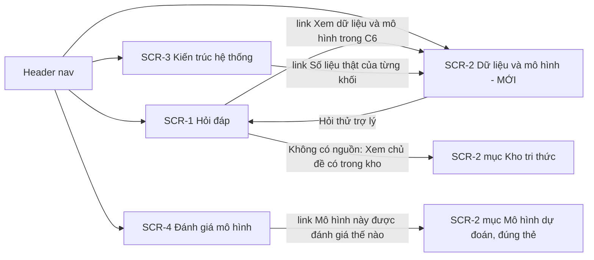
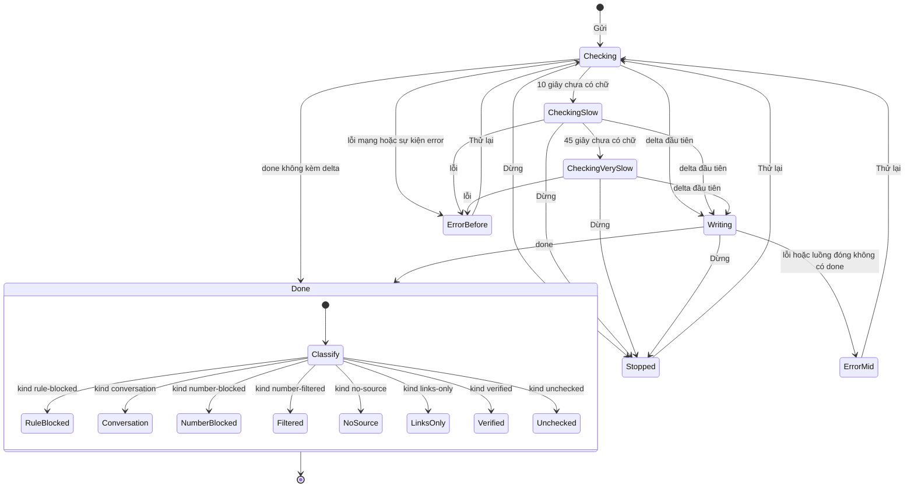

# REQ-DA-04 – Hiển thị phần dữ liệu AI trên web Đường An · design-ui.md

Người viết: Luna (UX) · Ngày: 2026-11-13 (giờ VN) · Nhánh khảo sát: `feature/dataset-kb-upgrade` · Người code: Neo (web).
Skill dùng: `ux-heuristic-review-dev-handoff` (khung mục), `ai-feature-ux-patterns`, `ui-states-microcopy-tokens`, `wcag22-aa-design-ui-checklist`.

**Chưa có `analysis.md` của REQ này.** Design bám brief của Atlas (13/11), đặt ID yêu cầu tạm `R-n` để Hawk truy vết; khi Vega viết analysis.md thì map `R-n → AC-n` (mục 8, Q1).

| ID | Yêu cầu (brief Atlas) | Ở đâu trong design |
|---|---|---|
| R-1 | Trạng thái câu trả lời AI: chờ 10–27 s có tiến trình theo bước, hủy, lỗi; "đã lược câu" / "bị chặn vì số không có nguồn" ngắn, dễ hiểu; chạy với cả NDJSON v1 lẫn stream theo câu (REQ-DA-03) | SCR-1.C1, C3, C4; 3a-1; 3b |
| R-2 | Trace: gộp bước trùng, nhãn tiếng Việt, số nguồn / số sự kiện đồ thị | SCR-1.C6; mục 2c |
| R-3 | Nguồn: phân biệt tài liệu đã duyệt (ADA/Bộ Y tế…), sự kiện đồ thị Neo4j, web chưa duyệt | SCR-1.C5 |
| R-4 | Khu "Dữ liệu & mô hình": model + dataset + chỉ số, LLM/embedding, quy mô KB/đồ thị; tách rõ dữ liệu đã có / cần endpoint mới | SCR-2; mục 6 |
| R-5 | Bảng handoff để Neo code không phải đoán | các bảng 2b, 3c, mục 6, mục 9 |

**Cách khảo sát:** Chrome extension không kết nối (thử 1 lần 13/11) → đọc code `frontend/src/*`, `backend/app/main.py`, `knowledge_graph.py`, `rag.py`, `artifacts/*/report.json`, worktree REQ-DA-03, gọi thật `POST :8001/api/chat/stream` và truy vấn Neo4j trong container `project-api-1`.

### Số liệu thật dùng trong design (13/11, đo trực tiếp)
- Neo4j: 251 `Document` = **61 đoạn đã duyệt** (`review_status` = null, 45 URL khác nhau) + **190 đoạn web chưa duyệt** (`unreviewed_web`); cả 251 có thuộc tính `embedding` (bge-m3). 79 `Topic`, 48 `Entity`, 25 `WebSource`. Quan hệ giữa thực thể: **53** (INCREASES_RISK_OF 9, DIAGNOSES 8, REDUCES_RISK_OF 8, HAS_SYMPTOM 8, CAN_CAUSE 8, MONITORED_BY 5, IS_A 3, CAUSES 2, PROGRESSES_TO 1, TREATS 1).
- **Không có vector index** (`SHOW INDEXES` chỉ có RANGE/LOOKUP). `rag.retrieve` so cosine trực tiếp trên thuộc tính `d.embedding`. ⇒ Câu "Tài liệu có vector" trong `Architecture.tsx` **đúng một nửa**: tài liệu có lưu vector, nhưng tìm kiếm là quét toàn bộ, không dùng vector index. Sửa copy ở `arch.kb.desc` (3c).
- Nguồn đã duyệt **không có trường cơ quan ban hành**: ADA nằm ở `pmc.ncbi.nlm.nih.gov`, Bộ Y tế nằm ở `benhviendakhoabaria.vn` ⇒ không suy ra được từ domain; chỉ đoán được từ tiêu đề ("Bộ Y tế Việt Nam: …", "(ADA 2026)"). Cần backend thêm `publisher` (mục 6, B-2).
- Sự kiện `done` mẫu (câu "HbA1c bao nhiêu thì chẩn đoán…"): 5 nguồn, trace `["Coordinator","Rule Agent","Rule Agent (Approved)","Knowledge Agent (Retrieved 3 sources)","Knowledge Graph Agent (3 facts, +1 linked docs)","Response Agent (Cited Generation)","Response Agent (Number check: passed)"]`. Thân câu trả lời có trích `[2]`, `[3]`.

### Lỗi đang có trong frontend (phát hiện khi khảo sát, Neo sửa trong REQ này)
- **BUG-1 (mức 4):** `isBlockedTrace` (`trace.ts:37`) dùng `/Blocked/i` trên mọi bước ⇒ trace `Response Agent (Number check: blocked, unsupported: …)` (đã có ở v1) bị coi là **chặn an toàn**: bong bóng hiện "Cảnh báo an toàn", nút **Gọi 115** và "Hệ thống dừng tại Rule Agent". Sai và gây hoảng.
- **BUG-2 (mức 3):** nút "Gọi 115" hiện cho mọi loại chặn, kể cả `PROMPT_INJECTION`, `MEDICATION_DOSAGE`, `PII_SENSITIVE`. Chỉ `EMERGENCY` mới cần.
- **BUG-3 (mức 2):** câu trả lời có `Number check: blocked` vẫn hiện disclaimer thường; câu trả lời `No source` vẫn hiện "Nguồn tham khảo" rỗng không có lối đi tiếp.

---

## 1 Screen flow



- SCR-2 là **view mới** `data` trong `views` của `main.tsx`, đặt sau "Kiến trúc hệ thống": nhãn `nav.data`. Không dùng router; điều hướng "đến đúng mục" = `setView('data')` + cuộn tới `id` của section (`#data-models`, `#data-kb`, `#model-<kind>`) + đưa focus vào heading đó (`tabIndex=-1`).
- Lượt chat của SCR-1 có máy trạng thái riêng – mục 3b.

---

## 2 Wireframes

### 2a Design system dùng
Dự án **không dùng thư viện component** (React + CSS thuần `style.css`, màu hex cứng). Quy tắc: tái dùng class sẵn có, chỉ thêm component nội bộ nhỏ, không cài thư viện mới.

| Có sẵn, dùng lại | Ở đâu |
|---|---|
| `.chat-bubble`, `.chat-row`, `.chat-avatar`, `.chat-error-msg`, `.chat-retry`, `.chat-stop`, `.chat-safety*` | SCR-1 |
| `SourceList` + `.src-badge-curated / -graph / -web` | SCR-1.C5 (viết lại phần nhóm) |
| `TracePipeline` + `formatTrace` + `.pstep-*` (màu theo agent) | SCR-1.C6 (viết lại logic gộp) |
| `<details className="chat-trace">` | Disclosure native – giữ |
| `.panel`, `.arch-box`, `.arch-layer`, `.eyebrow`, `.pagehead`, `.tabs` | SCR-2, SCR-3 |
| `.sr-only`, `:focus-visible` (outline 3px #2f6f4f) | toàn bộ |

| Component mới (nội bộ, file riêng) | Lý do không dùng cái có sẵn |
|---|---|
| `PendingTurn.tsx` | Chờ 10–27 s cần bước + thời gian trôi; `.chat-thinking` chỉ là 1 dòng chữ |
| `AnswerOutcome.tsx` | Trạng thái kết quả (lược câu, chặn số, không nguồn…) chưa có chỗ hiển thị |
| `CitedText.tsx` | Biến `[n]` trong câu trả lời thành nút nhảy tới nguồn |
| `SourceGroups.tsx` (thay phần thân `SourceList`, giữ export `SourceList` cho SCR-4) | Cần 3 nhóm + đếm |
| `TraceTimeline.tsx` (thay `TracePipeline` trong chat; SCR-4 vẫn dùng `TracePipeline` cũ hoặc dùng chung – Neo chọn, miễn 1 hàm gộp) | Gộp theo agent, nhiều dòng chi tiết |
| `DataModels.tsx` (SCR-2) + `about.ts` (fetch + kiểu `AboutInfo`) | Màn mới |
| `answerOutcome()` trong `trace.ts` | Hàm thuần, test được, mọi component đọc từ đây |

### 2b SCR-1 Hỏi đáp – lượt trả lời (R-1, R-2, R-3)

**Đang chờ (chưa có chữ):**
```
 ✳ ┌────────────────────────────────────────────────────────┐
   │ Đang xử lý câu hỏi · 14 giây                     [C1]   │
   │ ✓ Kiểm tra an toàn          (chỉ khi có sự kiện stage)  │
   │ ◌ Tìm tài liệu và đồ thị tri thức      ← đang chạy      │
   │ ○ Viết câu trả lời                                      │
   │ ○ Đối chiếu số liệu với nguồn                           │
   │ Câu hỏi tra cứu thường mất 10–30 giây.  (hiện từ 10 s)  │
   └────────────────────────────────────────────────────────┘
 [ Nhập câu hỏi…                                   ] [■ Dừng]
```

**Xong – có lược câu (stream v2) hoặc bình thường:**
```
 ✳ ┌────────────────────────────────────────────────────────┐
   │ Theo Bộ Y tế Việt Nam (QĐ 5481): … từ 6,5% trở lên [2]  │ ← [2] là nút (C2)
   │ Theo ADA 2026: … [3]                                    │
   │ ┌ ⓘ Đã lược 1/3 câu có số liệu nguồn không xác nhận ─┐ │ ← C3 (chỉ khi filtered)
   │ │   (70–99). Phần còn lại vẫn đúng theo nguồn.        │ │
   │ └──────────────────────────────────────────────────────┘ │
   │ ✓ Số liệu đã đối chiếu với nguồn · 3 tài liệu · 3 sự kiện đồ thị   ← C3 dòng tóm tắt
   │                                                         │
   │ Tài liệu đã duyệt (4)                            [C5]   │
   │  [Bộ Y tế] [2] Hướng dẫn chẩn đoán và điều trị ĐTĐ típ 2 ↗│
   │  [ADA]     [3] Tiêu chuẩn chẩn đoán … (ADA 2026) ↗      │
   │  [NIDDK]   [1] HbA1c là gì? … ↗                         │
   │  [NIDDK]   [4] Tiền đái tháo đường là gì … ↗             │
   │ Sự kiện từ đồ thị tri thức (3)                          │
   │  [Đồ thị]  [5] HbA1c · 3 quan hệ · nguồn gốc ↗          │
   │ ▸ Nguồn web chưa duyệt (2) – chỉ để tham khảo           │ ← đóng mặc định
   │                                                         │
   │ ▸ Các bước xử lý: 4 bước · 3 tài liệu · 3 sự kiện   [C6]│
   │ Thông tin tham khảo, không thay thế tư vấn của bác sĩ.  │
   └────────────────────────────────────────────────────────┘
```

**Xong – bị chặn vì số liệu (Number check: blocked):**
```
 ✳ ┌────────────────────────────────────────────────────────┐
   │ ⚠ Chưa hiển thị câu trả lời                       [C4]  │
   │ Câu trả lời tự sinh có con số mà nguồn không xác nhận    │
   │ (250, 13,8). Bạn có thể đọc thẳng các nguồn bên dưới.    │
   │ [Hỏi lại cách khác]   ▸ Xem thông báo đầy đủ            │
   │ Tài liệu đã duyệt (2) …                                 │
   │ ▸ Các bước xử lý …                                      │
   └────────────────────────────────────────────────────────┘
```

**Bảng component SCR-1** (chỉ phần mới/sửa; Composer, nút Gửi⇄Dừng, `role="log"` giữ như hiện tại)

| ID | Component | Variant/props | Dữ liệu | States | Event → kết quả | Tên a11y |
|---|---|---|---|---|---|---|
| SCR-1.C1 | `PendingTurn` | `phase: 'checking' \| 'writing'`, `startedAt: number` (ms, `performance.now()`), `stages?: StageEvent[]` | không có từ server ở v1/v2; `stages` chỉ khi backend thêm sự kiện `stage` (Q3) | `checking`, `writing`, `slow` (≥10 s), `very-slow` (≥45 s) | Dừng (nút composer) → `abort()` → state Stopped. Không tự huỷ theo thời gian | Container `aria-hidden="true"` (thông báo qua `#chat-status`, mục 4b) |
| SCR-1.C2 | `CitedText` | `text: string`, `sourceCount: number`, `onCite(n)` | `turn.content` | streaming, done | `[n]` với 1 ≤ n ≤ sourceCount → render `<button class="cite">`; click → mở nhóm chứa nguồn n (nếu đang đóng), cuộn + focus `#src-<turnIndex>-<n>`, item nháy viền 1,5 s (bỏ khi reduced-motion). `[n]` ngoài khoảng / khi đang stream (chưa có nguồn) → giữ text thường | `cite.a11y` |
| SCR-1.C3 | `AnswerOutcome` | `outcome: AnswerOutcome` (mục 2c) | `turn.trace`, `turn.sources` | xem 3a-1 hàng Done-* | dòng tóm tắt: click "Các bước xử lý" → mở C6 (`details.open = true`) và focus `summary` | – (text thường) |
| SCR-1.C4 | `BlockedNumberCard` / `SafetyCard` | `kind: 'number' \| 'rule'`, `category?`, `unsupported?: string[]`, `rawText: string` | trace + `turn.content` | number-blocked; rule-blocked (EMERGENCY / khác) | "Hỏi lại cách khác" → điền lại câu hỏi của lượt vào ô nhập, focus ô nhập, **không tự gửi**. "Xem thông báo đầy đủ" = `<details>` chứa `rawText`. `Gọi 115` (`tel:115`) **chỉ** khi `category === 'EMERGENCY'` | Tiêu đề là `<strong>` đầu card; nút có text |
| SCR-1.C5 | `SourceGroups` | `sources: Source[]`, `turnIndex`, `facts?: number` | `sources[].title,url,topic,review_status,fetched_at,publisher?,facts?` | có ≥1 nguồn; 0 nguồn → không render (C3 xử lý) | link ↗ mở tab mới; disclosure web chưa duyệt toggle | Heading nhóm `h3`/`strong` có số đếm; link có `.sr-only` "(mở trong tab mới)" như cũ |
| SCR-1.C6 | `TraceTimeline` | `trace: string[]`, `defaultOpen = false` cho **mọi** lượt, kể cả lượt cuối (chốt 13/11 khi duyệt code Neo: dòng tóm tắt C3 đã nêu số bước/tài liệu/sự kiện và mở được C6 bằng 1 click; mở sẵn làm bong bóng dài, đẩy nguồn xuống – H8. Khác bản cũ mở sẵn lượt cuối) | `turn.trace` | đóng/mở | mở/đóng native `<details>`; link `trace.more` → SCR-2 `#data-assistant` | `<ol aria-label=trace.listLabel>` |
| SCR-1.C7 | Thông báo trạng thái | `#chat-status` (`p.sr-only role="status"`, đã có) | – | – | – | xem 4b |

**Quy tắc nhóm nguồn (C5)** – thứ tự nhóm cố định, số `[n]` **giữ nguyên chỉ số gốc** (1-based theo mảng `sources`) vì thân câu trả lời trích theo số đó:

| Nhóm | Điều kiện | Badge | Ghi chú dưới mỗi item | Mặc định |
|---|---|---|---|---|
| Tài liệu đã duyệt | `review_status` null / `'curated'` / khác 2 giá trị dưới | `publisher` nếu có, ngược lại suy từ tiêu đề theo `publisherFromTitle` (bảng dưới), không suy được → `src.badge.reviewed` | `src.note.reviewed` + `topic` | mở |
| Sự kiện từ đồ thị tri thức | `review_status === 'curated_graph'` (giữ fallback cũ: tiêu đề bắt đầu "Đồ thị tri thức Neo4j") | `src.badge.graph` | tiêu đề bỏ tiền tố; `src.note.graph` với `{facts}` = số sự kiện (ưu tiên `source.facts?.length`, không có thì lấy `outcome.facts` từ trace); nếu có `source.facts[]` (B-3) thì liệt kê tối đa 5 dòng `từ —quan hệ→ tới (ngưỡng)` | mở |
| Nguồn web chưa duyệt | `review_status === 'unreviewed_web'` | `src.badge.web` | `src.note.web` + ngày thu thập `fetched_at` định dạng `dd/MM/yyyy` theo **Asia/Ho_Chi_Minh** (`Intl.DateTimeFormat('vi-VN',{timeZone:'Asia/Ho_Chi_Minh'})`) | **đóng** (`<details>`), trừ khi mọi nguồn đều là web (outcome `links-only`) thì mở |

Nhóm rỗng → không render. Trùng URL: giữ chú thích "Cùng liên kết với nguồn [k]" như hiện tại.

`publisherFromTitle` (fallback tạm, bỏ khi backend có `publisher`): `/Bộ Y tế/i → "Bộ Y tế"`, `/\bADA\b/ → "ADA"`, `/^WHO\b|\bWHO:/ → "WHO"`, `/\bCDC\b/ → "CDC"`, `/NIDDK/ hoặc host niddk.nih.gov → "NIDDK"`; còn lại `null`.

### 2c Logic `answerOutcome(trace)` và gộp trace (R-1, R-2) – đặt trong `trace.ts`, test thuần

**Kiểu:**
```ts
type AnswerOutcome = {
  kind: 'rule-blocked' | 'conversation' | 'no-source' | 'links-only'
      | 'number-blocked' | 'number-filtered' | 'verified' | 'unchecked';
  category?: 'EMERGENCY' | 'MEDICATION_DOSAGE' | 'PII_SENSITIVE' | 'PROMPT_INJECTION' | string;
  regenerated?: boolean;       // Number check: regenerated
  removed?: number; total?: number;   // filtered k/n
  unsupported?: string[];      // "70–99", "77" … (tách theo ", ")
  docs?: number;               // Retrieved N sources
  facts?: number; linkedDocs?: number;   // N facts, +M linked docs
};
```

**Thứ tự quyết định `kind` (gặp điều kiện đầu tiên thì dừng):**

| # | Điều kiện trên các dòng trace | kind |
|---|---|---|
| 1 | dòng khớp `^Rule Agent \(Blocked: (\w+)\)$` | `rule-blocked`, `category` = nhóm 1 |
| 2 | có dòng `Conversation Agent` | `conversation` |
| 3 | `Number check: blocked, unsupported: (.+)` | `number-blocked` |
| 4 | `Number check: filtered (\d+)/(\d+) sentences?(, unsupported: (.+))?` | `number-filtered` |
| 5 | `Response Agent (No source)` | `no-source` |
| 6 | `Response Agent (Links to unreviewed sources)` | `links-only` |
| 7 | `Number check: passed` hoặc `Number check: regenerated…` | `verified` (`regenerated=true` nếu regenerated) |
| 8 | còn lại (vd v2 status `skipped` không có dòng Number check) | `unchecked` |

`docs`, `facts`, `linkedDocs` đọc độc lập với `kind`. **Sửa BUG-1:** `isBlockedTrace` = `answerOutcome(trace).kind === 'rule-blocked'` (không còn `/Blocked/i`). Dòng trace không khớp mẫu nào: giữ nguyên văn (không mất thông tin), không làm vỡ UI.

**Gộp trace (C6):** tách `Tên (chi tiết)` như hiện tại → gộp **các dòng liên tiếp cùng tên agent** thành 1 bước có nhiều dòng chi tiết; dòng không có chi tiết bị nuốt nếu bước đó có chi tiết khác. Kết quả của trace mẫu: 4 bước (Coordinator bị bỏ – xem dưới).

| Tên agent (backend) | Nhãn hiển thị (key) | Phụ đề nhỏ | Icon trạng thái |
|---|---|---|---|
| `Coordinator` | **không hiển thị thành bước** (luôn có, không mang thông tin). Thay bằng câu dẫn `trace.intro` | – | – |
| `Rule Agent` | `trace.step.rule` | "Rule Agent" | ✓ approved / ✕ blocked |
| `Knowledge Agent` | `trace.step.knowledge` | "Knowledge Agent · RAG" | ✓ N>0 / – N=0 |
| `Knowledge Graph Agent` | `trace.step.graph` | "Knowledge Graph Agent · Neo4j" | ✓ có fact / – bỏ qua, không khớp |
| `Response Agent` | `trace.step.response` | "Response Agent · LLM" | ✓ / ! filtered/regenerated / ✕ number-blocked |
| `Conversation Agent` | `trace.step.conversation` | "Conversation Agent" | ✓ |
| khác | nguyên văn tên | – | – |

Icon luôn kèm chữ (không chỉ màu/icon): icon `aria-hidden`, trạng thái nằm trong câu chi tiết.

**Bảng dịch chi tiết** (thay `translations` hiện tại; text ở 3c):

| Mẫu chi tiết (regex, i) | Key |
|---|---|
| `^Approved$` | `trace.d.approved` |
| `^Blocked: EMERGENCY$` | `trace.d.blocked.emergency` |
| `^Blocked: MEDICATION_DOSAGE$` | `trace.d.blocked.dosage` |
| `^Blocked: PII_SENSITIVE$` | `trace.d.blocked.pii` |
| `^Blocked: PROMPT_INJECTION$` | `trace.d.blocked.injection` |
| `^Blocked\b` (khác) | `trace.d.blocked.other` |
| `^Retrieved (\d+) sources?$` | N>0 `trace.d.retrieved` · N=0 `trace.d.retrieved0` |
| `^(\d+) facts?,\s*\+(\d+) linked docs?$` | `trace.d.facts` (+ `trace.d.factsLinked` nếu M>0) |
| `^No matching entity$` | `trace.d.noEntity` |
| `^Skipped:\s*no relevant source$` | `trace.d.graphSkipped` |
| `^Cited Generation$` | `trace.d.cited` |
| `^No source$` | `trace.d.nosource` |
| `^Links to unreviewed sources$` | `trace.d.linksOnly` |
| `^Safety Directive$` | `trace.d.safety` |
| `^Number check: passed$` | `trace.d.num.passed` |
| `^Number check: regenerated, unsupported: (.+)$` | `trace.d.num.regenerated` |
| `^Number check: filtered (\d+)/(\d+) sentences?(, unsupported: (.+))?$` | `trace.d.num.filtered` |
| `^Number check: blocked, unsupported: (.+)$` | `trace.d.num.blocked` |
| `^DQN Policy$`, `^All modules completed$` (SCR-4 RL) | giữ bản dịch hiện tại |

**Ca test bắt buộc cho Neo (đầu vào → kỳ vọng):**

| # | trace | kind | Bước hiển thị |
|---|---|---|---|
| T1 | mẫu thật ở đầu file | verified, docs 3, facts 3, linked 1 | 4 bước: An toàn ✓ / Tìm tài liệu ✓ "3 tài liệu" / Đồ thị ✓ "3 sự kiện, kèm 1 tài liệu gốc" / Viết ✓ 2 dòng |
| T2 | `[…,"Rule Agent","Rule Agent (Blocked: EMERGENCY)","Response Agent (Safety Directive)"]` | rule-blocked EMERGENCY | có Gọi 115 |
| T3 | như T2 với `PROMPT_INJECTION` | rule-blocked | **không** có Gọi 115 |
| T4 | `[…,"Response Agent (Cited Generation)","Response Agent (Number check: blocked, unsupported: 77, 88)"]` | number-blocked, unsupported ["77","88"] | **không** "Cảnh báo an toàn", **không** Gọi 115 (BUG-1) |
| T5 | `…"Response Agent (Number check: filtered 1/3 sentences, unsupported: 70–99)"` | number-filtered 1/3, ["70–99"] | Viết "!" |
| T6 | `…"Knowledge Agent (Retrieved 0 sources)","Knowledge Graph Agent (Skipped: no relevant source)","Response Agent (No source)"` | no-source, docs 0 | |
| T7 | `…"Response Agent (Links to unreviewed sources)"` | links-only | nhóm web mở sẵn |
| T8 | `["Coordinator","Rule Agent","Rule Agent (Approved)","Conversation Agent"]` | conversation | 2 bước |
| T9 | `…"Response Agent (Number check: regenerated, unsupported: 77)"` | verified, regenerated | Viết "!" |
| T10 | `["Coordinator","Foo (Bar baz)"]` | unchecked | 1 bước "Foo" / "Bar baz" nguyên văn |
| T11 | `…"Response Agent (Number check: filtered 2/2 sentences)"` (không có unsupported) | number-filtered, unsupported [] | copy bản không ngoặc số |

### 2d SCR-2 Dữ liệu & mô hình (R-4) – view mới `data`

```
 ĐƯỜNG AN / DỮ LIỆU VÀ MÔ HÌNH
 Dữ liệu và mô hình đang chạy
 Hệ thống dùng những mô hình nào, học từ dữ liệu gì và được đánh giá ra sao.
 Số liệu đọc trực tiếp từ máy chủ lúc 13/11/2026 14:05.          [C1 · stale banner]

 Mục lục: Mô hình dự đoán · Trợ lý hỏi đáp · Kho tri thức · Nguồn đã duyệt · Giới hạn   [C0]

 ## Mô hình dự đoán (4)                                                       #data-models  [C2]
 ┌──────────────────────┬──────────┬────────┬──────────┬────────┬────────┬──────────┐
 │ Mô hình              │ Kiến trúc│ROC-AUC │F1 (nhóm  │Độ nhạy │Độ chính│ Tỉ lệ ca │
 │                      │          │        │ dương)   │(recall)│ xác dương│ dương   │
 ├──────────────────────┼──────────┼────────┼──────────┼────────┼────────┼──────────┤
 │ NHANES đầy đủ (15)   │ CNN 1D   │ 0,931  │ 0,755    │ 0,751  │ 0,758  │ 16,4 %   │
 │ NHANES rút gọn (4)   │ CNN 1D   │ 0,949  │ 0,726    │ 0,891  │ 0,612  │ 16,8 %   │
 │ BRFSS (lối sống)     │ MLP      │ 0,764  │ 0,382    │ 0,757  │ 0,256  │ 14,3 %   │
 │ UCI (triệu chứng)    │ MLP      │ 0,923  │ 0,833    │ 0,714  │ 1,000  │ 68,6 %   │
 └──────────────────────┴──────────┴────────┴──────────┴────────┴────────┴──────────┘
 Đọc bảng thế nào? (ⓘ disclosure)    Số đo trên tập kiểm tra, ngưỡng đang dùng ở web.
 ▸ NHANES đầy đủ (15 chỉ số) – chi tiết                       #model-nhanes15_research
     Dữ liệu: NHANES Hoa Kỳ 2015–2016 (huấn luyện) … Nhãn: tự khai đã từng được chẩn đoán (DIQ010)
     Chia tập: 1.680 / 414 / 2.038 · Ngưỡng 0,8 · Chọn theo ROC-AUC trên tập validation
     So với mô hình cơ sở: Hồi quy logistic ROC-AUC 0,950 (validation) …
     Ma trận nhầm lẫn (bảng 2×2 thật, có caption)
     Giới hạn: … (từ report)
   [Thử mô hình này →]  (→ SCR-4, chọn đúng tab dataset)
 ▸ … 3 mô hình còn lại

 ## Học tăng cường (DQN)                                                      [C3]
 Lợi ích trung bình mỗi lượt: DQN 2,03 · Luật tham lam 2,03 · Ngẫu nhiên 0,93 · Tối ưu 2,03
 Nhận xét: DQN đạt bằng luật tham lam đơn giản trên môi trường mô phỏng này.

 ## Trợ lý hỏi đáp                                                  #data-assistant  [C4]
 Mô hình ngôn ngữ  qwen3:4b-instruct (Ollama, chạy cục bộ)          ● Đang chạy
 Mô hình embedding bge-m3 (1024 chiều)
 Tìm tài liệu      3 đoạn gần nghĩa nhất, cosine ≥ 0,53, so trực tiếp (chưa dùng vector index)
 Kiểm tra an toàn  Rule Agent: cấp cứu, liều thuốc, thông tin cá nhân, chèn lệnh
 Đối chiếu số liệu Mỗi con số phải có trong tài liệu đã duyệt; sai thì lược câu hoặc không hiển thị

 ## Kho tri thức (Neo4j)                                            #data-kb        [C5]
 [ 61 đoạn tài liệu đã duyệt · 45 tài liệu ] [ 190 đoạn web chưa duyệt · 25 trang ]
 [ 79 chủ đề ] [ 48 thực thể ] [ 53 quan hệ giữa thực thể ]
 Quan hệ theo loại (bảng): Làm tăng nguy cơ 9 · Dùng để chẩn đoán 8 · …
 ▸ Danh sách 79 chủ đề

 ## Nguồn đã duyệt (45)                                             #data-sources   [C6]
 Lọc: (Tất cả) (Bộ Y tế) (ADA) (WHO) (CDC) (NIDDK) (Khác)
 Bảng: Cơ quan | Tài liệu ↗ | Chủ đề | Ngày cập nhật

 ## Giới hạn đã biết                                                              [C7]
 • … (danh sách, 3c)
```

**Bảng component SCR-2**

| ID | Component | Variant/props | Dữ liệu (mục 6) | States | Event → kết quả | Tên a11y |
|---|---|---|---|---|---|---|
| SCR-2.C0 | `<nav>` mục lục | link nội trang | – | – | click → cuộn + focus heading | `data.toc.label` |
| SCR-2.C1 | Dòng thời điểm + banner | – | `about.generated_at` | fresh, stale (>10 phút so với lúc tải trang không cần – chỉ hiện thời điểm), partial | nút `common.reload` → gọi lại `/api/about` | – |
| SCR-2.C2 | `ModelTable` + `ModelDetails` (`<details>` mỗi mô hình) | `models: ModelInfo[]` | `about.models[]` | loading, ok, error, partial (1 mô hình thiếu `metrics` → ô "—" + `data.models.missing`) | "Thử mô hình này" → `setView('risk')` + `setKind(kind)`; mở từ SCR-4 → mở đúng `<details>` | `<table>` có `<caption>` = `data.models.caption` |
| SCR-2.C3 | `RlSummary` | – | `about.rl` | ok, missing (`rl` null) | – | bảng 4 hàng có caption |
| SCR-2.C4 | `AssistantStack` (`<dl>`) | – | `about.assistant` + `health.services` | ok; LLM down → dòng trạng thái `data.llm.down` | link "Xem các bước trong một câu trả lời" → SCR-1 | – |
| SCR-2.C5 | `KbStats` (stat tile = `<dl>` lưới) + bảng quan hệ + `<details>` chủ đề | – | `about.kb` | ok, neo4j-down (`kb` null hoặc `kb.error`) | – | bảng có caption |
| SCR-2.C6 | `ReviewedSources` + nhóm nút lọc | `filter: string` | `about.kb.reviewed_sources[]` | ok, no-results (lọc = 0) | nút lọc = toggle button `aria-pressed` (giống `.tabs` SCR-4); bấm → lọc bảng, cập nhật `role="status"` "Đang hiện 12 tài liệu" | nhóm `role="group"` + `aria-label` = `data.src.filter` |
| SCR-2.C7 | `KnownLimits` (`<ul>`) | – | `about.limitations[]` (backend) + danh sách cố định ở 3c | – | – | – |

**Quy tắc hiển thị số (C2):**
- Định dạng `vi-VN`: 3 chữ số thập phân cho AUC/F1/recall/precision (`0,931`), phần trăm 1 chữ số (`16,4 %`), số lượng có dấu chấm nghìn (`418.492`).
- **Không** hiện accuracy ở bảng chính (BRFSS accuracy 0,650 trong khi ca dương chỉ 14 % – dễ hiểu sai); accuracy chỉ ở phần chi tiết, kèm câu `data.metric.accuracyNote`.
- Cột "Tỉ lệ ca dương" bắt buộc có – để người đọc so precision với tỉ lệ nền.
- Không tô màu "tốt/xấu" cho số. Không biểu đồ ở bản này (bảng đủ, dễ cho screen reader).
- Số trong wireframe lấy từ `report.json` hiện tại; Neo **không** hard-code, luôn đọc từ API.

### 2e SCR-3 Kiến trúc – sửa nhỏ
- `Box "Neo4j KB"`: `desc` = `arch.kb.desc` (bỏ câu "Tài liệu có vector" chưa chính xác).
- Cuối trang thêm 1 link `arch.toData` → SCR-2.

### 2f SCR-4 Đánh giá mô hình – sửa nhỏ
- Dưới `.score-note` của kết quả thêm 1 dòng: `risk.modelInfo` + link `risk.modelInfo.link` → SCR-2 `#model-<kind>`. Nếu `/api/about` chưa có → vẫn hiện link (SCR-2 tự xử lý lỗi), không hiện số.

---

## 3 States

### 3a-1 SCR-1 một lượt trả lời AI

| State | Khi nào | UI | Copy (key) | Điều khiển |
|---|---|---|---|---|
| Checking | đã gửi, chưa có `delta` | C1 phase `checking`; thời gian trôi hiện từ giây thứ 3 | `pending.title`, `pending.elapsed`, `pending.step.*` | Dừng |
| Checking-slow | ≥ 10 s chưa có chữ | thêm dòng gợi ý | `pending.slow` | Dừng |
| Checking-very-slow | ≥ 45 s chưa có chữ | thay gợi ý | `pending.verySlow` | Dừng (không tự huỷ) |
| Writing | đã có ≥1 `delta`, chưa `done` | text chạy trong bong bóng + dòng `pending.writing` nhỏ cuối bong bóng (như `MSG_WRITING` hiện tại); `[n]` chưa thành nút | `pending.writing` | Dừng |
| Done-verified | outcome `verified` | thân + C3 dòng tóm tắt (✓) + C5 + C6 + disclaimer | `outcome.verified` / `outcome.regenerated` | – |
| Done-filtered | `number-filtered` | thân (đoạn `REMOVED_NOTE` bị thay, xem dưới) + C3 khung ⓘ | `outcome.filtered`, `outcome.filtered.noNums` | – |
| Done-number-blocked | `number-blocked` | C4 kind `number` **thay** thân; thân gốc vào "Xem thông báo đầy đủ" | `blockedNum.title`, `blockedNum.body`, `blockedNum.retry`, `blockedNum.raw` | Hỏi lại cách khác |
| Done-no-source | `no-source` | thân (backend từ chối) + C3 khung gợi ý + lối thoát không-AI | `outcome.nosource`, `outcome.nosource.link` | link → SCR-2 `#data-kb` |
| Done-links-only | `links-only` | thân + C3 cảnh báo + nhóm web mở sẵn | `outcome.linksOnly` | – |
| Done-unchecked | `unchecked` có nguồn đã duyệt | thân + C3 dòng trung tính | `outcome.unchecked` | – |
| Done-rule-blocked | `rule-blocked` | `.chat-safety` + tiêu đề theo category; Gọi 115 chỉ EMERGENCY; không C5; C6 vẫn có | `safety.title.*`, `safety.note`, `safety.call` | Gọi 115 (EMERGENCY) |
| Done-conversation | `conversation` | thân, không C3/C5; C6 vẫn có | – | – |
| Stopped | người dùng bấm Dừng | giữ phần đã có + `chat.stopped` (có sẵn) | `chat.stopped` | Thử lại (gửi lại câu hỏi – như hiện tại) |
| Error-before | lỗi trước chữ đầu | bong bóng lỗi (có sẵn) | `ERR_NETWORK` / `ERR_SERVER` (giữ `api.ts`) | Thử lại |
| Error-mid | lỗi sau khi có chữ | giữ phần đã có + `ERR_INTERRUPTED` (có sẵn) | giữ | Thử lại |

**Đoạn REMOVED_NOTE (stream v2):** backend chèn `"\n\n" + REMOVED_NOTE` vào thân (text cố định trong `number_guard.py`). Khi outcome là `number-filtered` **và** thân có đoạn khớp **nguyên văn** hằng `REMOVED_NOTE_V2` (Neo copy chuỗi vào `trace.ts`, ghi comment nguồn) → bỏ đoạn đó khỏi thân và hiện khung C3 thay thế. Không khớp (backend đổi chữ) → để nguyên thân, vẫn hiện khung C3 (chấp nhận lặp ý, không mất thông tin).

**Đoạn tail web chưa duyệt** (`"Các nguồn web tự động khác được hiển thị…"`): giữ nguyên trong thân (không xử lý).

**NDJSON v1 vs v2 – cùng một code:** v1 phát toàn bộ ~1 s trước `done` (Writing rất ngắn), v2 phát theo câu (Writing dài hơn). UI chỉ dựa vào: có `delta` chưa, `done.trace`, `done.sources`. Sự kiện có `type` lạ → **bỏ qua** (đã đúng trong vòng lặp hiện tại – giữ, có test). Không cần cờ phiên bản.

### 3a-2 SCR-2 Dữ liệu & mô hình

| Vùng | Loading | OK | Empty | Error | Partial |
|---|---|---|---|---|---|
| Toàn trang | skeleton 3 khối (bảng 5 hàng, 2 khối `dl`), `aria-busy="true"` trên `<main>` vùng nội dung; `data.loading` qua status | các section | – | `/api/about` 404 → `data.error.notReady` + vẫn hiện C4 phần lấy từ `/api/health` (tên dịch vụ, trạng thái) ; mạng/5xx → `data.error.load` + `common.reload` | xem từng vùng |
| C2 Mô hình | (chung) | bảng | `models` rỗng → `data.models.empty` | – | 1 mô hình thiếu metrics → hàng "—" + `data.models.missing` |
| C3 RL | – | bảng | `rl` null → `data.rl.missing` | – | – |
| C4 Trợ lý | – | `dl` | – | – | `health.services.ollama=false` → `data.llm.down` cạnh tên mô hình |
| C5 Kho | – | tile + bảng | – | `kb` null → `data.kb.down` | – |
| C6 Nguồn | – | bảng | lọc 0 → `data.src.noResults` + nút `data.src.clear` | – | – |

### 3b State diagram – một lượt chat



### 3c Bảng copy (nơi duy nhất chứa text UI)

`{x}` là biến. Số định dạng `vi-VN`. Danh sách số `unsupported` nối bằng ", ", tối đa 3 mục rồi "…".

| Key | Text | Dùng ở |
|---|---|---|
| nav.data | Dữ liệu và mô hình | Header nav |
| pending.title | Đang xử lý câu hỏi | SCR-1.C1 |
| pending.elapsed | {s} giây | SCR-1.C1 (từ giây 3, cập nhật mỗi 1 s) |
| pending.step.safety | Kiểm tra an toàn | SCR-1.C1 |
| pending.step.retrieve | Tìm tài liệu và đồ thị tri thức | SCR-1.C1 |
| pending.step.write | Viết câu trả lời | SCR-1.C1 |
| pending.step.check | Đối chiếu số liệu với nguồn | SCR-1.C1 |
| pending.slow | Câu hỏi tra cứu thường mất 10–30 giây. | SCR-1.C1 |
| pending.verySlow | Lâu hơn thường lệ. Bạn có thể chờ thêm, hoặc bấm Dừng rồi hỏi ngắn gọn hơn. | SCR-1.C1 |
| pending.writing | Đang viết câu trả lời… | SCR-1 bong bóng (giữ `MSG_WRITING`) |
| status.start | Đang xử lý câu hỏi. | `#chat-status` |
| status.slow | Vẫn đang xử lý, thường mất 10–30 giây. | `#chat-status` (1 lần ở 10 s) |
| status.writing | Đang viết câu trả lời. | `#chat-status` (1 lần ở delta đầu) |
| status.done | Đã trả lời xong, {n} nguồn. | `#chat-status` (giữ như hiện tại) |
| status.doneNoSource | Đã trả lời xong. | `#chat-status` |
| status.blockedNum | Câu trả lời chưa được hiển thị vì có số liệu chưa có nguồn. | `#chat-status` |
| status.cite | Đã chuyển tới nguồn [{n}]. | `#chat-status` (khi bấm `[n]`) |
| cite.a11y | Xem nguồn {n} | SCR-1.C2 `aria-label` |
| outcome.verified | Số liệu đã đối chiếu với nguồn | SCR-1.C3 |
| outcome.regenerated | Số liệu đã đối chiếu với nguồn (đã viết lại 1 lần) | SCR-1.C3 |
| outcome.unchecked | Câu trả lời này chưa qua bước đối chiếu số liệu. | SCR-1.C3 |
| outcome.count.docs | {n} tài liệu | SCR-1.C3 |
| outcome.count.facts | {n} sự kiện đồ thị | SCR-1.C3 |
| outcome.traceLink | Các bước xử lý | SCR-1.C3 |
| outcome.filtered | Đã lược {k}/{n} câu có số liệu nguồn không xác nhận ({nums}). Phần còn lại khớp với nguồn. | SCR-1.C3 |
| outcome.filtered.noNums | Đã lược {k}/{n} câu có số liệu nguồn không xác nhận. Phần còn lại khớp với nguồn. | SCR-1.C3 |
| outcome.nosource | Kho tri thức chưa có tài liệu đủ sát với câu hỏi này. Thử hỏi cụ thể hơn, ví dụ nêu rõ chỉ số (HbA1c, đường huyết lúc đói) hoặc tổ chức (ADA, Bộ Y tế). | SCR-1.C3 |
| outcome.nosource.link | Xem các chủ đề có trong kho | SCR-1.C3 → SCR-2 `#data-kb` |
| outcome.linksOnly | Chỉ tìm thấy trang web chưa được duyệt, nên trợ lý không tóm tắt nội dung. Hãy tự mở và đọc các liên kết dưới đây. | SCR-1.C3 |
| blockedNum.title | Chưa hiển thị câu trả lời | SCR-1.C4 |
| blockedNum.body | Câu trả lời tự sinh có con số mà nguồn không xác nhận ({nums}). Bạn có thể đọc thẳng các nguồn bên dưới. | SCR-1.C4 |
| blockedNum.bodyNoNums | Câu trả lời tự sinh có con số mà nguồn không xác nhận. Bạn có thể đọc thẳng các nguồn bên dưới. | SCR-1.C4 |
| blockedNum.retry | Hỏi lại cách khác | SCR-1.C4 nút |
| blockedNum.raw | Xem thông báo đầy đủ | SCR-1.C4 `summary` |
| safety.title.emergency | Có dấu hiệu cần cấp cứu | SCR-1.C4 rule |
| safety.title.dosage | Không hướng dẫn liều thuốc | SCR-1.C4 rule |
| safety.title.pii | Không xử lý thông tin cá nhân | SCR-1.C4 rule |
| safety.title.injection | Yêu cầu không được thực hiện | SCR-1.C4 rule |
| safety.title.other | Yêu cầu không được thực hiện | SCR-1.C4 rule |
| safety.note | Hệ thống dừng ở bước kiểm tra an toàn, không tìm tài liệu. | SCR-1.C4 rule (thay `.chat-safety-note` cũ) |
| safety.call | Gọi 115 | SCR-1.C4 (chỉ EMERGENCY) |
| src.group.reviewed | Tài liệu đã duyệt ({n}) | SCR-1.C5 |
| src.group.graph | Sự kiện từ đồ thị tri thức ({n}) | SCR-1.C5 |
| src.group.web | Nguồn web chưa duyệt ({n}) – chỉ để tham khảo | SCR-1.C5 `summary` |
| src.badge.reviewed | Đã duyệt | SCR-1.C5 (khi không biết cơ quan) |
| src.badge.graph | Đồ thị | SCR-1.C5 |
| src.badge.web | Chưa duyệt | SCR-1.C5 |
| src.note.reviewed | Bản tóm tắt biên soạn thủ công từ nguồn chính thống · {topic} | SCR-1.C5 |
| src.note.graph | {facts} quan hệ trích từ đồ thị tri thức Neo4j, liên kết tới tài liệu gốc | SCR-1.C5 |
| src.note.graphNoCount | Quan hệ trích từ đồ thị tri thức Neo4j, liên kết tới tài liệu gốc | SCR-1.C5 |
| src.note.web | Tự động thu thập ngày {date}, chưa được kiểm duyệt chuyên môn | SCR-1.C5 |
| src.sameLink | Cùng liên kết với nguồn [{k}] | SCR-1.C5 (giữ) |
| src.newTab | (mở trong tab mới) | SCR-1.C5 `.sr-only` (giữ) |
| trace.summary | Các bước xử lý: {steps} bước | SCR-1.C6 `summary` (nối thêm ` · ` + `outcome.count.*` khi > 0) |
| trace.intro | Coordinator (LangGraph) chuyển câu hỏi qua các tác tử sau: | SCR-1.C6 |
| trace.listLabel | Các bước tác tử đã xử lý câu trả lời | SCR-1.C6 `aria-label` (giữ) |
| trace.more | Xem các mô hình đang dùng | SCR-1.C6 → SCR-2 `#data-assistant` |
| trace.step.rule | Kiểm tra an toàn | SCR-1.C6 |
| trace.step.knowledge | Tìm tài liệu | SCR-1.C6 |
| trace.step.graph | Tra đồ thị tri thức | SCR-1.C6 |
| trace.step.response | Viết câu trả lời | SCR-1.C6 |
| trace.step.conversation | Trò chuyện | SCR-1.C6 |
| trace.d.approved | Đạt: không có dấu hiệu cần dừng | SCR-1.C6 |
| trace.d.blocked.emergency | Dừng: có dấu hiệu cấp cứu | SCR-1.C6 |
| trace.d.blocked.dosage | Dừng: câu hỏi về liều thuốc | SCR-1.C6 |
| trace.d.blocked.pii | Dừng: có thông tin cá nhân nhạy cảm | SCR-1.C6 |
| trace.d.blocked.injection | Dừng: câu hỏi chứa lệnh điều khiển hệ thống | SCR-1.C6 |
| trace.d.blocked.other | Dừng vì lý do an toàn | SCR-1.C6 |
| trace.d.retrieved | Tìm thấy {n} tài liệu gần nghĩa | SCR-1.C6 |
| trace.d.retrieved0 | Không có tài liệu đủ gần nghĩa | SCR-1.C6 |
| trace.d.facts | {n} sự kiện từ đồ thị | SCR-1.C6 |
| trace.d.factsLinked | , kèm {m} tài liệu gốc | SCR-1.C6 (nối sau `trace.d.facts`) |
| trace.d.noEntity | Không có thực thể khớp trong đồ thị | SCR-1.C6 |
| trace.d.graphSkipped | Bỏ qua vì không có tài liệu liên quan | SCR-1.C6 |
| trace.d.cited | Viết câu trả lời chỉ từ nguồn, có trích dẫn | SCR-1.C6 |
| trace.d.nosource | Không có nguồn phù hợp: từ chối, không suy diễn | SCR-1.C6 |
| trace.d.linksOnly | Chỉ có nguồn web chưa duyệt: đưa liên kết, không tóm tắt | SCR-1.C6 |
| trace.d.safety | Gửi hướng dẫn an toàn | SCR-1.C6 |
| trace.d.num.passed | Đối chiếu số liệu: mọi con số đều có trong nguồn | SCR-1.C6 |
| trace.d.num.regenerated | Đối chiếu số liệu: viết lại 1 lần vì {nums} không có trong nguồn | SCR-1.C6 |
| trace.d.num.filtered | Đối chiếu số liệu: lược {k}/{n} câu có số không có trong nguồn ({nums}) | SCR-1.C6 |
| trace.d.num.filteredNoNums | Đối chiếu số liệu: lược {k}/{n} câu có số không có trong nguồn | SCR-1.C6 (trace không có `unsupported`, ca T11) |
| trace.d.num.blocked | Đối chiếu số liệu: không hiển thị câu trả lời vì {nums} không có trong nguồn | SCR-1.C6 |
| data.eyebrow | ĐƯỜNG AN / DỮ LIỆU VÀ MÔ HÌNH | SCR-2 |
| data.title | Dữ liệu và mô hình đang chạy | SCR-2 `h1` |
| data.lead | Hệ thống dùng những mô hình nào, học từ dữ liệu gì và được đánh giá ra sao. | SCR-2 |
| data.generatedAt | Số liệu đọc trực tiếp từ máy chủ lúc {time}. | SCR-2.C1 (`dd/MM/yyyy HH:mm`, Asia/Ho_Chi_Minh) |
| data.toc.label | Mục lục trang | SCR-2.C0 |
| data.toc.models | Mô hình dự đoán | SCR-2.C0 (tiêu đề `h2` có "({n})" nên mục lục dùng key riêng không số) |
| data.toc.kb | Kho tri thức | SCR-2.C0 |
| data.toc.sources | Nguồn đã duyệt | SCR-2.C0 |
| data.loading | Đang tải thông tin mô hình và kho tri thức… | SCR-2 status |
| data.error.load | Không tải được thông tin mô hình. Kiểm tra kết nối rồi bấm Tải lại. | SCR-2 |
| data.error.notReady | Máy chủ chưa cung cấp thông tin chi tiết về mô hình và kho tri thức. Dưới đây là trạng thái dịch vụ hiện có. | SCR-2 (404) |
| common.reload | Tải lại | SCR-2 |
| data.models.title | Mô hình dự đoán ({n}) | SCR-2.C2 `h2` |
| data.models.caption | Chỉ số trên tập kiểm tra, tại ngưỡng phân loại đang dùng trên web | SCR-2.C2 caption |
| data.models.col.name | Mô hình | SCR-2.C2 |
| data.models.col.arch | Kiến trúc | SCR-2.C2 |
| data.models.col.auc | ROC-AUC | SCR-2.C2 |
| data.models.col.f1 | F1 (nhóm dương) | SCR-2.C2 |
| data.models.col.recall | Độ nhạy | SCR-2.C2 |
| data.models.col.precision | Độ chính xác dương | SCR-2.C2 |
| data.models.col.base | Tỉ lệ ca dương | SCR-2.C2 |
| data.models.help | Đọc bảng thế nào? | SCR-2.C2 `summary` |
| data.models.helpBody | ROC-AUC từ 0,5 (đoán ngẫu nhiên) đến 1 (tách hoàn hảo). Độ nhạy: trong số người đã được chẩn đoán, mô hình nhận ra bao nhiêu. Độ chính xác dương: trong số người mô hình xếp vào nhóm dương, bao nhiêu thật sự đã được chẩn đoán. So độ chính xác dương với tỉ lệ ca dương để thấy mô hình hơn đoán mò bao nhiêu. | SCR-2.C2 |
| data.models.empty | Chưa có mô hình nào được huấn luyện. | SCR-2.C2 |
| data.models.missing | Chưa có báo cáo đánh giá cho mô hình này. | SCR-2.C2 |
| data.models.details | {name} – chi tiết | SCR-2.C2 `summary` |
| data.model.dataset | Dữ liệu | SCR-2.C2 `dt` |
| data.model.label | Nhãn dự đoán | SCR-2.C2 `dt` |
| data.model.split | Chia tập (huấn luyện / kiểm định / kiểm tra) | SCR-2.C2 `dt` |
| data.model.threshold | Ngưỡng phân loại | SCR-2.C2 `dt` |
| data.model.baseline | So với mô hình cơ sở | SCR-2.C2 `dt` |
| data.model.confusion | Ma trận nhầm lẫn trên tập kiểm tra | SCR-2.C2 caption |
| data.model.limits | Giới hạn | SCR-2.C2 `dt` |
| data.model.try | Thử mô hình này | SCR-2.C2 nút |
| data.model.accuracy | Độ chính xác tổng thể | SCR-2.C2 chi tiết `dt` (đi kèm `data.metric.accuracyNote`) |
| data.cm.actualNeg | Thực tế: chưa được chẩn đoán | SCR-2.C2 ma trận nhầm lẫn, `th scope="row"` |
| data.cm.actualPos | Thực tế: đã được chẩn đoán | SCR-2.C2 ma trận, `th scope="row"` |
| data.cm.predNeg | Mô hình: nhóm âm | SCR-2.C2 ma trận, `th scope="col"` |
| data.cm.predPos | Mô hình: nhóm dương | SCR-2.C2 ma trận, `th scope="col"` |
| data.metric.accuracyNote | Độ chính xác tổng thể dễ gây hiểu nhầm khi ít ca dương; xem thêm độ nhạy và độ chính xác dương. | SCR-2.C2 chi tiết |
| data.rl.title | Học tăng cường (DQN) | SCR-2.C3 `h2` |
| data.rl.caption | Lợi ích trung bình mỗi lượt trên môi trường mô phỏng (5 seed × {episodes} lượt) | SCR-2.C3 caption |
| data.rl.note | Phần thưởng là giả lập, không phải bằng chứng lâm sàng. | SCR-2.C3 |
| data.rl.missing | Chưa có báo cáo của mô hình học tăng cường. | SCR-2.C3 |
| data.assistant.title | Trợ lý hỏi đáp | SCR-2.C4 `h2` |
| data.assistant.llm | Mô hình ngôn ngữ | SCR-2.C4 `dt` |
| data.assistant.embed | Mô hình embedding | SCR-2.C4 `dt` |
| data.assistant.dim | {n} chiều | SCR-2.C4, sau tên embedding: "bge-m3 (1024 chiều)" |
| data.assistant.ask | Xem các bước trong một câu trả lời | SCR-2.C4 link → SCR-1 |
| data.assistant.retrieval | Tìm tài liệu | SCR-2.C4 `dt` |
| data.assistant.retrievalValue | {k} đoạn gần nghĩa nhất, độ tương đồng cosine từ {min} trở lên; so trực tiếp trên vector đã lưu, chưa dùng vector index | SCR-2.C4 `dd` |
| data.assistant.rule | Kiểm tra an toàn | SCR-2.C4 `dt` |
| data.assistant.ruleValue | Dừng trước khi tra cứu nếu có dấu hiệu cấp cứu, hỏi liều thuốc, thông tin cá nhân nhạy cảm hoặc lệnh điều khiển hệ thống | SCR-2.C4 `dd` |
| data.assistant.guard | Đối chiếu số liệu | SCR-2.C4 `dt` |
| data.assistant.guardValue | Mỗi con số trong câu trả lời phải có trong tài liệu đã duyệt (hoặc quy đổi đơn vị bằng hệ số có trong nguồn); câu sai bị lược, sai hết thì không hiển thị câu trả lời | SCR-2.C4 `dd` |
| data.llm.running | Đang chạy | SCR-2.C4 |
| data.llm.down | Chưa chạy | SCR-2.C4 |
| data.kb.title | Kho tri thức (Neo4j) | SCR-2.C5 `h2` |
| data.kb.reviewedChunks | đoạn tài liệu đã duyệt | SCR-2.C5 tile |
| data.kb.reviewedDocs | tài liệu đã duyệt | SCR-2.C5 tile |
| data.kb.webChunks | đoạn web chưa duyệt | SCR-2.C5 tile |
| data.kb.webPages | trang web nguồn | SCR-2.C5 tile |
| data.kb.topics | chủ đề | SCR-2.C5 tile |
| data.kb.entities | thực thể | SCR-2.C5 tile |
| data.kb.relations | quan hệ giữa thực thể | SCR-2.C5 tile |
| data.kb.relCaption | Quan hệ trong đồ thị theo loại | SCR-2.C5 caption |
| data.kb.topicList | Danh sách {n} chủ đề | SCR-2.C5 `summary` |
| data.kb.down | Không đọc được kho tri thức Neo4j lúc này. Các mô hình dự đoán vẫn dùng được. | SCR-2.C5 |
| rel.INCREASES_RISK_OF | Làm tăng nguy cơ | SCR-2.C5, SCR-1.C5 facts |
| rel.REDUCES_RISK_OF | Làm giảm nguy cơ | 〃 |
| rel.DIAGNOSES | Dùng để chẩn đoán | 〃 |
| rel.HAS_SYMPTOM | Có triệu chứng | 〃 |
| rel.CAN_CAUSE | Có thể gây | 〃 |
| rel.CAUSES | Gây ra | 〃 |
| rel.MONITORED_BY | Theo dõi bằng | 〃 |
| rel.IS_A | Là một loại | 〃 |
| rel.PROGRESSES_TO | Có thể tiến triển thành | 〃 |
| rel.TREATS | Dùng để điều trị | 〃 |
| rel.other | {type} (nguyên văn) | 〃 |
| data.src.title | Nguồn đã duyệt ({n}) | SCR-2.C6 `h2` |
| data.src.filter | Lọc theo cơ quan ban hành | SCR-2.C6 |
| data.src.all | Tất cả | SCR-2.C6 |
| data.src.other | Khác | SCR-2.C6 |
| data.src.col.publisher | Cơ quan | SCR-2.C6 |
| data.src.col.title | Tài liệu | SCR-2.C6 |
| data.src.col.topic | Chủ đề | SCR-2.C6 |
| data.src.col.date | Ngày cập nhật | SCR-2.C6 |
| data.src.count | Đang hiện {n} tài liệu. | SCR-2.C6 status |
| data.src.noResults | Không có tài liệu nào của {publisher}. | SCR-2.C6 |
| data.src.clear | Hiện tất cả | SCR-2.C6 |
| data.limits.title | Giới hạn đã biết | SCR-2.C7 `h2` |
| data.limits.1 | Mô hình dự đoán học từ khảo sát Hoa Kỳ (NHANES, BRFSS) và bộ UCI nhỏ; chưa kiểm chứng trên người Việt Nam, không dùng để sàng lọc hay chẩn đoán. | SCR-2.C7 |
| data.limits.2 | Nhãn NHANES và BRFSS là tự khai "đã từng được chẩn đoán", không phải xét nghiệm xác nhận. | SCR-2.C7 |
| data.limits.3 | Trợ lý chỉ trả lời trong phạm vi {reviewedDocs} tài liệu đã duyệt; câu hỏi ngoài phạm vi sẽ bị từ chối. | SCR-2.C7 |
| data.limits.4 | Câu hỏi gõ không dấu được khôi phục dấu tự động và có thể bị hiểu sai; nên gõ có dấu. | SCR-2.C7 |
| data.limits.5 | Khi so sánh hai hướng dẫn (ví dụ ADA và Bộ Y tế), trợ lý có thể chỉ tìm thấy một bên; hãy kiểm tra nhóm "Tài liệu đã duyệt" xem có đủ hai cơ quan không. | SCR-2.C7 |
| data.limits.6 | Bước đối chiếu số liệu có thể lược cả câu đúng nhưng dùng phép tính lạ, nên câu trả lời đôi khi bị cụt. | SCR-2.C7 |
| arch.kb.desc | Tài liệu kèm vector embedding (bge-m3) và đồ thị thực thể; tìm bằng so cosine trực tiếp | SCR-3 |
| arch.toData | Xem số liệu thật của từng khối: Dữ liệu và mô hình → | SCR-3 |
| risk.modelInfo | Mô hình này được đánh giá thế nào? | SCR-4 |
| risk.modelInfo.link | Xem chỉ số và dữ liệu huấn luyện | SCR-4 |

Copy **giữ nguyên** (đã có, không đổi): `ERR_NETWORK`, `ERR_SERVER`, `ERR_INTERRUPTED`, `ERR_GENERIC`, `MSG_OLLAMA_DOWN`, `chat.stopped` ("Đã dừng trả lời."), disclaimer "Thông tin tham khảo, không thay thế tư vấn của bác sĩ.", hint composer.

---

## 4 Interaction & accessibility

### 4a SC đã kiểm (tự rà trên design + code, chưa test screen reader thật)
1.3.1, 1.4.1, 1.4.3, 1.4.10, 1.4.11, 2.1.1, 2.4.3, 2.4.6, 2.4.7, 2.4.11, 2.5.8, 3.2.1, 4.1.2, 4.1.3, 2.2.1 (không có giới hạn thời gian tự huỷ – thời gian chờ chỉ để thông tin).

### 4b Bàn phím, focus, tên a11y, live region

**SCR-1**
- Giữ nguyên: transcript `role="log"` + `aria-busy` trong lúc chờ/stream; nút Gửi⇄Dừng; Enter/Shift+Enter (thêm `e.keyCode === 229` cạnh `isComposing` theo skill D2 – hiện thiếu).
- **Live region:** chỉ dùng `#chat-status` sẵn có (không thêm vùng mới). Trình tự đọc: `status.start` → (10 s) `status.slow` một lần → `status.writing` một lần → `status.done` / `status.doneNoSource` / `status.blockedNum`. **Không** đọc số giây (bộ đếm `aria-hidden`), không đọc từng bước.
- Bộ đếm giây: cập nhật bằng `setInterval` 1 s, dừng khi rời Checking; `prefers-reduced-motion` không ảnh hưởng (text, không animation). Chấm "đang chạy" ◌ dùng animation CSS → tắt khi reduced-motion (đã có rule chung).
- `[n]` (C2): `<button type="button" class="cite">` inline, Tab tới được. Kích hoạt → mở `<details>` nhóm web nếu nguồn nằm trong đó → `focus()` item `#src-{turn}-{n}` (`tabIndex=-1`, `li`) → `scrollIntoView({block:'nearest'})` → `status.cite`. Target nhỏ: đặt `padding` để vùng bấm ≥ 24×24 px hoặc khoảng cách đủ (2.5.8).
- C4 "Hỏi lại cách khác": điền ô nhập, focus `#chat-question`, đặt con trỏ cuối. Không tự gửi.
- C6 / nhóm web: `<details>/<summary>` native (Enter/Space). Không thêm ARIA.
- Tab order trong một bong bóng: các nút `[n]` trong thân → nút C4 (nếu có) → `summary` "Xem thông báo đầy đủ" → link nguồn (theo nhóm) → `summary` nhóm web → link C3 "Các bước xử lý" → `summary` C6 → link `trace.more` → Thử lại (nếu lỗi).
- Màu không là tín hiệu duy nhất: nhóm nguồn có heading chữ + badge chữ; bước trace có chữ trạng thái.

**SCR-2**
- Một `h1`, mỗi khối `h2`. Chi tiết mô hình: `summary` chỉ chứa text `data.models.details`, **không** đặt heading trong `summary` (một số screen reader đọc mất vai trò nút).
- Bảng: `<table>` thật, `<caption>`, `<th scope="col">`, cột tên mô hình `<th scope="row">`. Số căn phải, `font-variant-numeric: tabular-nums`.
- Mục lục C0 + điều hướng từ trang khác: cuộn tới section, focus `h2` (`tabIndex=-1`); trước đó đặt `scroll-padding-top` = chiều cao header sticky (2.4.11).
- Nút lọc C6: toggle button `aria-pressed`, nhãn cố định; nhóm `role="group"` + `aria-label`. Kết quả lọc báo qua 1 `p.sr-only role="status"` của SCR-2 (dùng chung với `data.loading`).
- Trạng thái dịch vụ: chấm màu `aria-hidden` + chữ `data.llm.running/down`.
- Loading: `aria-busy="true"` trên vùng nội dung; `data.loading` qua status nếu > 1 s.
- Tab order: nav → C0 → C1 nút Tải lại (nếu có) → C2 `summary` "Đọc bảng" → mỗi `summary` mô hình → nút "Thử mô hình này" → C4 link → C5 `summary` chủ đề → C6 nút lọc → link tài liệu.

### 4c Responsive
- ≤ 800 px (breakpoint sẵn có): bảng mô hình C2 **không** cuộn ngang toàn trang – bọc `div` `overflow-x:auto` có `tabIndex=0` + `aria-label` = caption (ngoại lệ bảng của 1.4.10), cột tên mô hình `position: sticky; left: 0`.
- ≤ 700 px: tile C5 xếp 2 cột; bảng nguồn C6 chuyển thành danh sách thẻ (mỗi thẻ: badge cơ quan, tiêu đề link, chủ đề · ngày).
- 320 px: C1 các bước xếp dọc như wireframe (đã dọc), C3 khung bọc chữ, không chiều cao cố định (1.4.12).

---

## 5 Design tokens

### 5a Token dùng
Dự án chưa có hệ token (hex cứng trong `style.css`). **Không** refactor toàn bộ trong REQ này. Component mới khai báo biến CSS dưới đây trong `:root` (kiểu tên nhà mình `--color-<thuộc tính>-<ngữ nghĩa>[-state]`) và **chỉ** dùng biến, không hex trực tiếp. Giá trị lấy lại đúng màu đang dùng để nhất quán.

| Token | Giá trị | Dùng cho | Contrast đo |
|---|---|---|---|
| `--color-text-default` | #24342e | thân chữ | 12,19:1 trên #f7f7f4 |
| `--color-text-muted` | #55685c | ghi chú, bộ đếm, phụ đề agent | 5,56:1 trên #f7f7f4 · 5,96:1 trên #fff |
| `--color-border-focus` | #2f6f4f | `:focus-visible` (đã có) | 5,58:1 trên nền |
| `--color-bg-source-reviewed` / `--color-text-source-reviewed` | #dcefe2 / #1d5a37 | badge đã duyệt | 6,80:1 |
| `--color-bg-source-graph` / `--color-text-source-graph` | #e7e0f7 / #4a2f94 | badge đồ thị | 7,72:1 |
| `--color-bg-source-web` / `--color-text-source-web` | #fff0cf / #7a4a00 | badge chưa duyệt | 6,63:1 |
| `--color-bg-safety` / `--color-text-safety` / `--color-border-safety` | #fff4ee / #8a3a12 / #b4572a | C4 rule-blocked (đã có) | chữ 7,21:1 · viền 4,84:1 |

### 5b Token mới
| Token | Giá trị | Lý do | Contrast |
|---|---|---|---|
| `--color-bg-notice` / `--color-text-notice` | #fff7e0 / #5c4a00 | C3 khung "đã lược câu", C4 kind `number` – cần khác màu cấp cứu (không gây hoảng) | 8,06:1 |
| `--color-bg-info` / `--color-text-info` | #e6eef8 / #1e4f8a | C3 `no-source`, `links-only`, SCR-2 banner `data.error.notReady` | 7,07:1 |

Viền khung C3/C4 number: `1px solid` cùng màu chữ (≥ 3:1). Không thêm component thư viện.

---

## 6 Data needed per screen

### 6a SCR-1 – đã có, không cần backend mới
| Dữ liệu | Nguồn hiện có |
|---|---|
| `delta.text`, `done.sources[]{title,url,topic,review_status,fetched_at}`, `done.trace[]`, `error` | `POST /api/chat/stream` (v1 và v2 cùng schema) |
| outcome, số tài liệu, số sự kiện đồ thị, số câu lược, số bị chặn | **parse từ `done.trace`** (mục 2c) |
| category chặn an toàn | trace `Rule Agent (Blocked: <CATEGORY>)` |
| REMOVED_NOTE | hằng nguyên văn từ `number_guard.py` (REQ-DA-03) |

### 6b SCR-1 – nên có (backend, **không** giao Neo; UI chạy được khi thiếu)
| ID | Field thêm vào mỗi phần tử `done.sources[]` | Dùng ở | Khi thiếu |
|---|---|---|---|
| B-1 | `review_status: 'curated'` thay vì `null` cho tài liệu đã duyệt | C5 | coi null = đã duyệt |
| B-2 | `publisher: 'ADA' \| 'Bộ Y tế' \| 'WHO' \| 'CDC' \| 'NIDDK' \| string \| null` (thuộc tính mới trên `Document`, nạp từ `sources*.json`) | C5 badge, SCR-2.C6 lọc | `publisherFromTitle` |
| B-3 | Với nguồn `curated_graph`: `facts: [{from, type, to, threshold?}]` (đã có sẵn trong `facts_to_source`, chỉ đang bị bỏ ở `summary`) | C5 liệt kê quan hệ | chỉ hiện số từ trace |
| B-4 | (tùy chọn, Q3) sự kiện `{"type":"stage","name":"rule"\|"retrieve"\|"graph"\|"write"\|"check"}` trước `delta` đầu | C1 tick từng bước thật | C1 chỉ 2 phase |

### 6c SCR-2 – cần endpoint mới `GET /api/about` (backend – Rex; Neo chỉ gọi)
Hiện frontend chỉ có `/api/health` (trả cờ có/không có model, neo4j/ollama true/false; **không** có tên model, chỉ số, quy mô KB).

```jsonc
{
  "generated_at": "2026-11-13T14:05:00+07:00",          // ISO 8601 có offset +07:00
  "models": [{
    "kind": "nhanes15_research",                          // khớp Kind của SCR-4
    "name": "NHANES đầy đủ (15 chỉ số)",
    "architecture": "CNN 1D",                             // "MLP" | "CNN 1D"
    "available": true,                                    // = health.models[kind]
    "dataset": { "name": "NHANES Hoa Kỳ", "cycles": ["2015–2016","2017–2018"], "label": "Tự khai đã từng được chẩn đoán (DIQ010)",
                 "n_train": 1680, "n_validation": 414, "n_test": 2038, "positive_rate_test": 0.164 },
    "threshold": 0.8,
    "metrics_test": { "roc_auc": 0.931, "f1_pos": 0.755, "recall_pos": 0.751, "precision_pos": 0.758, "accuracy": 0.920,
                      "brier": 0.092, "confusion_matrix": [[1624,80],[83,251]], "auc_ci95": [0.913,0.949] },  // null nếu report không có
    "baseline": { "name": "Hồi quy logistic", "split": "validation", "roc_auc": 0.950, "f1_pos": 0.670 },        // null nếu không có
    "selection_rule": "…",                                // chuỗi tiếng Việt hoặc null
    "limitations": ["…"]                                  // tiếng Việt
  }],
  "rl": { "episodes_per_seed": 200, "seeds": 5,
          "results": [{ "policy": "DQN", "mean_return": 2.026, "std_return": 0.042 }, …] } | null,
  "assistant": { "llm": "qwen3:4b-instruct", "llm_provider": "Ollama", "embedding": "bge-m3", "embedding_dim": 1024,
                 "top_k": 3, "min_cosine": 0.53, "vector_index": false, "number_guard": "v2" },
  "kb": {
    "reviewed_chunks": 61, "reviewed_docs": 45, "web_chunks": 190, "web_pages": 25,
    "topics": 79, "entities": 48, "relations": 53,
    "relations_by_type": [{ "type": "INCREASES_RISK_OF", "count": 9 }, …],
    "topic_names": ["…"],
    "reviewed_sources": [{ "title": "…", "url": "…", "publisher": "Bộ Y tế", "topic": "…", "date": "2026-11-12" }]   // 1 dòng / URL
  } | null,                                               // null khi Neo4j lỗi; phần còn lại vẫn trả 200
  "limitations": ["…"]                                    // tùy chọn, nối vào data.limits.*
}
```
Ghi chú cho Rex/Vega (không phải việc UI): 4 `report.json` khác cấu trúc (`neural_network.classification_report` / `cnn` / `test_selected_only`) → backend chuẩn hoá về `metrics_test`; tỉ số chọn **ngưỡng đang dùng ở `/api/predict`** (0,5 hoặc `selected_threshold`). Số đếm KB đọc trực tiếp Neo4j, có thể cache ≤ 5 phút. Không trả hash file, đường dẫn máy.

### 6d SCR-4
`kind` hiện tại → link `#model-<kind>`. Không thêm field.

---

## 7 Heuristic self-review

Tự rà soát 1 người, chưa test người dùng, chưa test screen reader thật.

| ID | Màn | Heuristic | Vấn đề (hiện trạng → design) | Mức | Sửa trong design |
|---|---|---|---|---|---|
| HR-1 | SCR-1 | H2, H9 | Bị chặn vì số → hiện "Cảnh báo an toàn" + Gọi 115 (BUG-1) | 4 | `answerOutcome` tách `number-blocked` khỏi `rule-blocked`; C4 kind number |
| HR-2 | SCR-1 | H2 | Gọi 115 cho cả chèn lệnh/hỏi liều (BUG-2) | 3 | chỉ EMERGENCY; tiêu đề theo category |
| HR-3 | SCR-1 | H1 | Chờ 10–27 s chỉ có 1 dòng chữ tĩnh | 3 | C1: bước + thời gian trôi + gợi ý ở 10 s/45 s |
| HR-4 | SCR-1 | H2, H8 | Thông báo chặn số dài, liệt kê tiêu đề | 3 | C4 tiêu đề ngắn + câu 1 dòng; bản dài vào disclosure |
| HR-5 | SCR-1 | H2 | Trace lặp "Rule Agent" và chuỗi tiếng Anh | 3 | gộp theo agent, nhãn Việt, bỏ Coordinator |
| HR-6 | SCR-1 | H6 | Nguồn đã duyệt và đồ thị lẫn nhau, không thấy ADA/Bộ Y tế | 3 | C5 3 nhóm + badge cơ quan |
| HR-7 | SCR-1 | H6 | `[n]` trong câu không bấm được, phải dò danh sách | 2 | C2 nút nhảy tới nguồn |
| HR-8 | SCR-1 | H3, H9 | Không có nguồn → ngõ cụt | 3 | gợi ý hỏi cụ thể + link chủ đề trong kho (lối thoát không-AI) |
| HR-9 | toàn web | H10, H1 | Không có chỗ xem model, chỉ số, dataset, quy mô KB | 3 | SCR-2 |
| HR-10 | SCR-3 | H2 | "Tài liệu có vector" gây hiểu là có vector index | 2 | `arch.kb.desc` |
| HR-11 | SCR-2 | H2 | Accuracy dễ gây hiểu sai khi lệch lớp (BRFSS) | 3 | bỏ accuracy khỏi bảng chính, thêm tỉ lệ ca dương + giải thích |
| HR-12 | SCR-1 | H2 | Câu trả lời tự mâu thuẫn / sai ngưỡng với câu không dấu (Atlas đo) | 3 | **ngoài phạm vi UI** (chất lượng RAG/LLM) → mục 8 Q5; UI chỉ giảm hại bằng C5 (thấy cơ quan nào) + `data.limits.4/5` |
| HR-13 | SCR-1 | H1 | Stream v2: đoạn REMOVED_NOTE trùng ý với khung C3 | 1 | thay khi khớp nguyên văn; không khớp thì chấp nhận lặp |

Không còn mục ≥ 3 chưa có cách sửa trong design (HR-12 là vấn đề backend, đã chuyển).

**Definition of Ready**
- [x] Đủ 8 mục (+ mục 9 danh sách việc)
- [x] Mỗi component trong wireframe có dòng ở bảng component
- [x] Mỗi vùng dữ liệu có đủ state; mọi key copy có text ở 3c
- [x] Mỗi state của lượt chat có node trong 3b
- [x] Mỗi event ghi kết quả
- [ ] Field khớp design-data.md – **chưa có design-data.md**; field đề xuất ở 6b/6c chờ Vega/Rex chốt (Q2)
- [x] Mục 4 điền theo checklist; icon-only control có tên a11y
- [x] Rà 10 heuristic: không còn mức ≥ 3 chưa xử lý trong phạm vi UI
- [ ] Mỗi AC-n được tham chiếu – chưa có AC; dùng R-1…R-5 (Q1)
- [x] Ghi rõ: tự rà soát 1 người, chưa test người dùng

---

## 8 Câu hỏi mở / để sau

| # | Câu hỏi | Cho ai | Mặc định nếu không trả lời |
|---|---|---|---|
| Q1 | REQ-DA-04 chưa có analysis.md; có cần Vega viết AC trước khi Neo code? | Atlas/Vega | Neo code theo R-1…R-5 + ca test T1–T11; Hawk kiểm theo bảng 3a |
| Q2 | Ai làm `GET /api/about` và B-1…B-3 (backend)? | Atlas → Rex | Neo làm phần A (không cần backend) trước; SCR-2 code với fixture JSON đúng schema 6c, hiển thị `data.error.notReady` khi 404 |
| Q3 | Có thêm sự kiện `stage` (B-4) không? REQ-DA-03 chốt giữ schema v1 | Vega/Rex | Không. C1 chỉ 2 phase thật (`checking` → `writing`), bước còn lại hiện dạng danh sách "sẽ chạy" không tick, **không giả tiến độ** |
| Q4 | Thứ tự nav: thêm tab thứ 6 hay gộp SCR-2 vào "Kiến trúc hệ thống"? | Boss | Tab riêng sau Kiến trúc (giảng viên vào thẳng được) |
| Q5 | Lỗi nội dung Atlas đo (so sánh ADA–Bộ Y tế 1 nguồn, câu tự mâu thuẫn "70-99", câu không dấu trả ngưỡng bình thường) | Pollux/Rex | Ngoài phạm vi UI; đề xuất REQ riêng hoặc gắn vào regression REQ-DA-03 (RG nhóm so sánh, không dấu) |
| Q6 | Có hiện AUC cho từng nhóm con (giới, tuổi) ở SCR-2? report có `subgroup_analysis` | Boss | Để sau (bản này chỉ chỉ số tổng) |
| Q7 | Có cần nút 👍/👎 theo skill AI? | Boss | Ngoài phạm vi REQ này (chưa có nơi lưu góp ý) |

---

## 9 Danh sách việc cho Neo (web) – đề xuất chia task

Chỉ mảng web. Không sửa backend, không đụng dòng footer đang sửa dở của Boss trong `main.tsx` (dòng ~724) – làm trong worktree từ HEAD.

| Task | Nội dung | File | Phụ thuộc |
|---|---|---|---|
| W-1 | `answerOutcome()` + gộp/dịch trace mới, sửa `isBlockedTrace` (BUG-1); unit test T1–T11 | `trace.ts`, test mới | – |
| W-2 | `TraceTimeline` (C6) dùng W-1; dòng tóm tắt C3 | `TraceTimeline.tsx`, `main.tsx` | W-1 |
| W-3 | `PendingTurn` (C1): 2 phase, đếm giây, ngưỡng 10/45 s, status messages; thêm `keyCode 229` | `PendingTurn.tsx`, `main.tsx` | – |
| W-4 | `AnswerOutcome` + `BlockedNumberCard` + sửa `SafetyCard` (BUG-2, BUG-3); xử lý REMOVED_NOTE | `AnswerOutcome.tsx`, `main.tsx` | W-1 |
| W-5 | `SourceGroups` (3 nhóm, badge cơ quan, `publisherFromTitle`, ngày giờ VN) + `CitedText` | `SourceGroups.tsx`, `SourceList.tsx`, `CitedText.tsx` | W-1 |
| W-6 | View `data` (SCR-2) + `about.ts` (kiểu theo 6c, fixture, xử lý 404/lỗi/partial) | `DataModels.tsx`, `about.ts`, `main.tsx` | Endpoint thật: Q2 (code trước bằng fixture) |
| W-7 | Sửa copy SCR-3 + link sang SCR-2; link từ SCR-4 | `Architecture.tsx`, `main.tsx` | W-6 |
| W-8 | Token CSS 5a/5b cho component mới | `style.css` | – |

Evidence Neo cần nộp: unit test W-1 (T1–T11) xanh; ảnh chụp 7 trạng thái Done + Checking-slow + SCR-2 (OK, 404, Neo4j down) ở 1280 px và 320 px; chạy được với server :8001 (v1) và, khi Boss bật, :8002 (v2).
